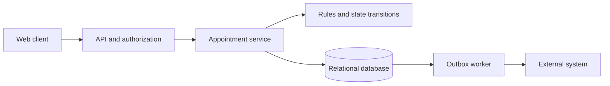
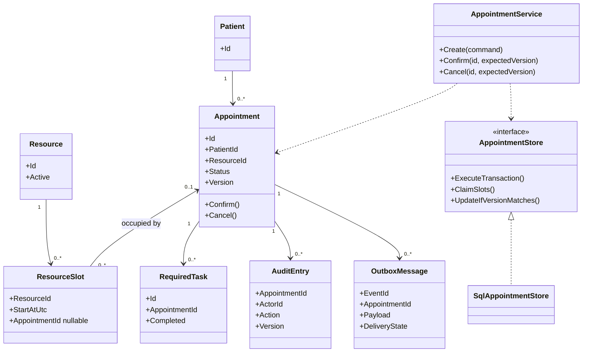
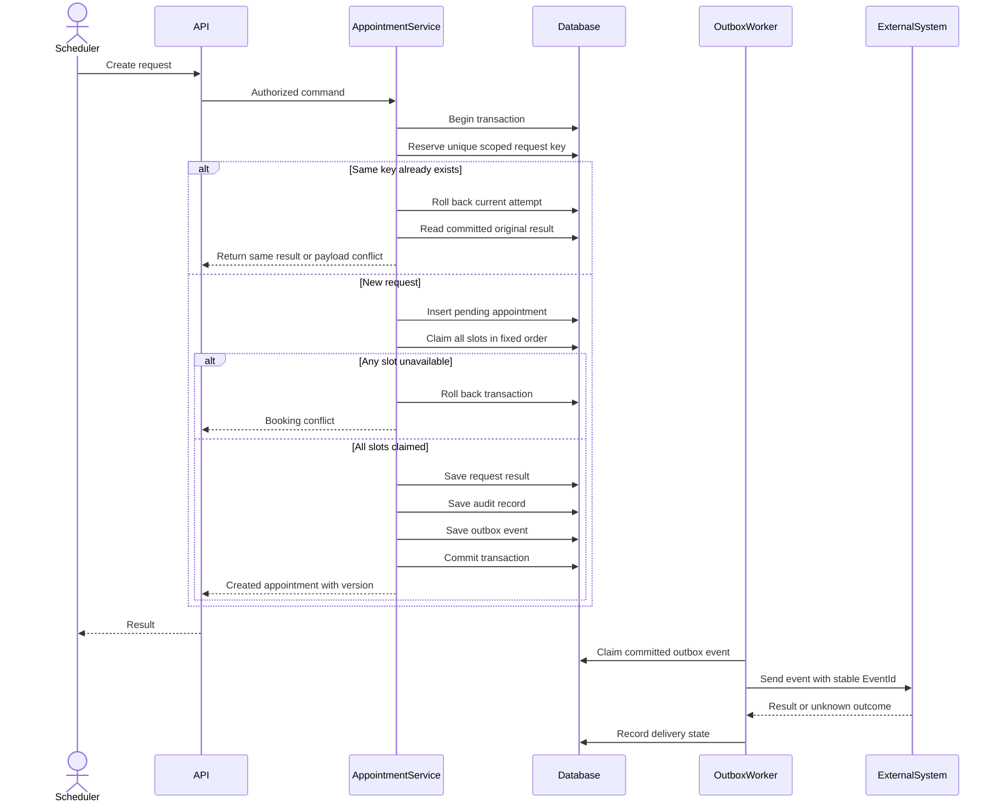

# 架构师面试：从零系统设计与UML

这是虚构的预约排程练习，不是MOSAIQ内部实现，也不涉及治疗决策或设备控制。目标是展示建模、接口、事务、失败恢复与取舍。与12的简化状态机不同，本题允许Confirmed→Cancelled；面试时以给定题目为准。

## 1. 英文题目与第一步

> Design a system for booking appointments for patients. Each appointment uses one resource for one or more time slots. Users can create, confirm, cancel, and view appointments. Show the main classes and the flow for creating an appointment. Explain how you prevent double booking.

先问4–6个问题，别连续问二十个：

> Who are the users, and which actions can each user perform?
> Are time slots fixed, or can an appointment start at any time?
> Can an appointment use more than one slot?
> What happens when two users book the same slot?
> What checks are needed before confirmation?
> Do we need to notify an external system?

**演练假设：**固定15分钟时段；每个预约一个资源，可连续占多时段；Pending创建即占位；Confirmed后可取消；管理员维护资源，排程人员预约，临床角色完成前置任务并确认。预计内部团队使用，规模未给出，先做模块化单体+关系数据库。所有身份和数据均虚构。

真实面试时不要把假设说成临床固定流程；让面试官同意或调整。

> I will assume fixed time slots for the first version. If that is not correct, I will adjust the model.

## 2. 先写业务不变量

1. 一个资源的同一时段最多被一个有效预约占用。
2. 一个预约要么占到全部时段，要么一个都不占。
3. Confirm前必须满足要求的任务；Cancelled不能再Confirm。
4. 更新需携带用户读到的版本，过期修改不覆盖新内容。
5. 同一创建请求重试不新增预约；相同请求key换内容被拒绝。
6. 业务变更和审计记录同时提交；外部通知失败不抹掉本地预约。
7. 后端按操作和对象范围授权，不只隐藏前端按钮。

英文概述：

> The database must prevent two appointments from owning the same slot.
> A booking must save all its slots together.
> A retry must not create another booking.

## 3. 最小架构与职责



- API：鉴权、输入边界、错误映射、请求ID。
- Appointment service：协调事务，编排预约/占位/任务/审计/outbox；不把事务散到Controller。
- Domain规则：合法状态、时长和连续时段、确认条件。
- Data access：条件更新、唯一约束、事务执行。
- 外部client：协议与响应解释；worker：重试、状态与可观测性。

**为什么先单体：**

> I would start with a modular monolith because the booking changes need one clear transaction.
> The modules can still have separate responsibilities.
> I would add more services only when there is a clear need.

不因为听到architect就先画微服务。需求没说外部同步时，可以不引入outbox，先画本地主链路。

## 4. UML类图：对象、关系与依赖



图说明：一个Slot可空闲或被一个预约占用；一个预约占多个Slot。Cancelled释放Slot，因此历史时间范围应保存在Appointment或不可变历史，不依赖当前占位关系还原历史。

UML口述：

> The appointment owns its state rules.
> The service coordinates the transaction.
> The store handles persistence.
> Each slot has at most one appointment owner.

UML不只画框：association是对象关系，虚线dependency是使用关系，接口实现是realization。不要用继承表示“预约包含患者”。无需为每个类强行造接口；这里的store接口只表达用例所需的持久化边界。

## 5. 表与关键约束

| 表 | 关键字段 | 约束/目的 |
|---|---|---|
| Patient | Id, SourceSystem, ExternalId | 外部身份需有命名空间 |
| Resource | Id, Active | 停用影响需明确 |
| ResourceSlot | ResourceId, StartAtUtc, AppointmentId nullable | PK(ResourceId,StartAtUtc)，预生成有效时段 |
| Appointment | Id, PatientId, ResourceId, StartAtUtc, SlotCount, Status, Version | FK；时间范围用于历史保留 |
| RequiredTask | Id, AppointmentId, Type, Completed | 确认前的规则输入 |
| IdempotencyRequest | Scope, Key, PayloadHash, AppointmentId | UNIQUE(Scope,Key)，key绑定内容和原结果 |
| AuditEntry | Id, AppointmentId, ActorId, Action, FromVersion, ToVersion, AtUtc | 与业务事务提交；访问受控 |
| OutboxMessage | EventId, AppointmentId, EventType, Payload, State, AttemptCount | 持久化待同步事件与失败信息 |

不声称一个唯一索引能禁止任意时间区间重叠。本题固定Slot，才可按PK和原子占用保证冲突。任意开始/结束时间需要另选范围排他约束（特定引擎支持时）或可靠资源行锁/隔离设计；普通“先查重叠再插入”有竞争窗口。

时间输入明确时区，内部保存UTC，展示转本地；跨夏令时或不存在的本地时间需要明确校验规则。

## 6. 创建预约：UML时序与事务



幂等唯一冲突的具体处理依数据库而异：有些引擎约束错误会让事务进入失败状态，需要回滚后读取原已提交结果；原请求仍处理中时可返回明确处理中或有界等待。不能在所有引擎里“捕获异常后继续同事务”一概而论。并发相同key对同一结果的重用必须定义清楚。

本练习避免网络调用包在数据库事务中；返回成功代表本地预约提交，外部同步显示独立状态。

### 占位的原子写入

先验证时段存在、连续、可预约，随后逐个按固定顺序执行；检查每个影响行数：

```sql
UPDATE ResourceSlot
SET AppointmentId = @appointmentId
WHERE ResourceId = @resourceId
  AND StartAtUtc = @slotStart
  AND AppointmentId IS NULL;
```

某一步0行：整个事务回滚，包括已经占到的时段和新预约。两个用户都在页面看到空闲，也只有一个事务能占住同一Slot。

预约冲突通常不应盲目重试同一个已被占时段。数据库死锁可对整个可安全重试的事务做有界重试；由于事务中没有远程动作，重试边界更清楚。顺序统一降低风险，但不保证整个系统绝不死锁。

> Checking availability is useful for the page, but it is not the final guarantee.
> The conditional database write is the final check.

## 7. 确认、取消与版本冲突

### Confirm

事务中读取/锁定预约；验证版本与Pending，读取必要任务，检查全部完成，再更新Status+Version并写审计/outbox。

若任务完成状态可以被撤销，任务修改与Confirm必须共享约定的锁/版本规则。例如所有任务修改先锁对应预约行，且确认后不允许撤销；否则“刚查全完成，另一个事务撤销任务”仍可能出错。不能只写“在一个事务里”就假定所有竞争自动被处理。

### Cancel

校验版本及Pending/Confirmed；更新为Cancelled、版本加1；按固定顺序释放**确实归本预约拥有**的Slot；审计/outbox同事务。非法状态或版本不匹配不释放时段。

```sql
UPDATE ResourceSlot
SET AppointmentId = NULL
WHERE ResourceId = @resourceId
  AND StartAtUtc = @slotStart
  AND AppointmentId = @appointmentId;
```

最后一个条件防止误清理其他预约。重复取消作为API幂等返回还是状态错误，需要另定义；与12练习的简化选择可以不同。

### 改期扩展

锁定当前预约并验证版本 → 同事务保留旧占位并尝试新Slot（已归自己所有的重叠Slot可保留）→ 新位置全成功后释放不再需要的旧Slot → 更新范围与版本。冲突回滚，旧预约仍有效。取消、改期、创建须约定跨预约/Slot的锁层次与顺序，避免各入口反向加锁。

## 8. API与错误契约

| API | 输入重点 | 返回 |
|---|---|---|
| POST /appointments | 请求key、patient、resource、start、slotCount | 201+Id+Version；重复原请求返回原结果；内容冲突409 |
| GET /appointments/{id} | 对象权限 | 200或404 |
| POST /appointments/{id}/confirm | expectedVersion | 200；版本/状态/前置任务冲突409 |
| POST /appointments/{id}/cancel | expectedVersion | 200；冲突409 |
| GET /appointments | 范围、过滤、pageSize、cursor | 有界结果，确定排序 |

非法输入400，未认证401，权限不足403；实际404是否用于隐藏资源存在由团队策略确定。本表是自定义API，不是FHIR接口。FHIR If-Match版本失败的标准语义不能直接用本表409代替。

每个错误带稳定code和可读message，如 `VersionConflict`、`SlotUnavailable`、`PrerequisiteIncomplete`；不要把数据库内部异常原文直接返回。日志用correlation ID，不把完整患者内容写进去。

## 9. 外部同步、Outbox与未知结果

> I save the appointment and the event in one transaction.
> A worker sends the event later.
> The worker may send it more than once, so the receiver needs a stable event ID.
> If the result is unknown, I need a query or reconciliation path.

Outbox解决“本地业务提交却没留下通知意图”的窗口；不保证远端恰好一次执行。发送成功但worker在记成功前崩溃，重试会重复发送。下游需幂等、查询或受控核查；不能盲目把超时记成确定失败。

单worker是初版选择；多worker需原子领取、租约与过期恢复。重试指数退避、有上限、区分暂时失败与永久错误。更新事件乱序时，下游按对象版本或协议顺序处理，不能只比本机时间。监控待发送年龄、失败次数和异常队列。

## 10. 如何测试与解释取舍

| 风险 | 关键测试 |
|---|---|
| 双预约 | 两连接争同Slot，最多一个成功 |
| 半预约 | 多Slot中最后一个冲突，前面占位全部回滚 |
| 同key重试 | 相同内容返回同预约，内容不同409 |
| 过期修改 | 两用户读同版本，一个成功，一个冲突 |
| 确认规则 | 缺任务、全完成、并发撤销任务 |
| 取消/改期 | 取消释放自身时段；改期冲突旧位置不丢 |
| 原子审计 | 审计写入失败时业务变更不提交 |
| 同步故障 | 已提交事件可恢复；重复发送下游不重复生效 |
| 升级 | 历史状态/字段、脚本中断、回退兼容 |
| 权限 | 无权限不能靠直接调用API越权 |

**性能：**先按时间范围和资源查询建候选索引，测计划、读量和锁等待；不承诺某QPS。将报表与关键写事务分开考虑，避免长事务。

**取舍：**固定Slot简单、冲突可控，但粒度限制排程；单体容易事务一致，但扩展需清晰模块；Pending立即占位简单，但需要定义超时释放；外部最终一致提高故障可恢复性，但UI要显示同步状态。

## 11. 2分钟英文设计总结

> I would start with a web API, a relational database, and clear modules.
> The main objects are Patient, Resource, Slot, and Appointment.
> A new appointment holds all its slots in one transaction.
> Each slot can have only one owner. A conditional update prevents double booking.
>
> Updates include the version that the user read. An old version returns a conflict.
> Confirmation checks the required tasks. Cancellation releases only the slots owned by that appointment.
> I save the audit record with the business change.
>
> If an external system needs an update, I would save an outbox event in the same transaction.
> The worker can retry, but the receiver still needs idempotency.
> I would test conflicts, rollback, repeated requests, and recovery first.

此段可拆成三次回答，别一口气讲完后不给面试官参与。

## 12. 换题怎么迁移

库存：Slot→库存额度，原子扣减 `quantity >= requested`。

报告导出：Appointment→分析run，状态和reviewVersion变成核心，版本绑定比占位重要。

文件导入：请求ID、输入hash、任务状态、完整产物发布与校验。

审计记录查询：先定义谁可看、查询范围和数据保留；append-only表本身不等于不可篡改证明。

统一步骤：需求例子 → 不变量 → 对象与状态 → 写事务 → 外部效果 → 测试 → 取舍。不要迁移业务假设本身。
