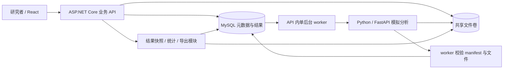
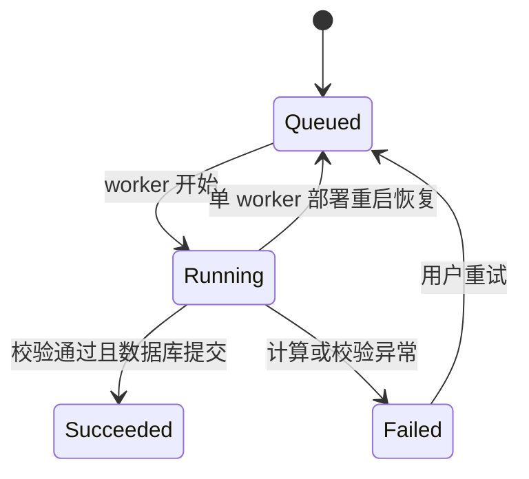

# 系统设计答题套路：用 OncoMosaic 讲清楚架构决策

整理日期：2026-10-11。适用于架构师二面的白板设计、项目架构追问与从零设计练习。例子来自当前仓库代码；扩展方案明确标为设计建议，不代表已上线能力或 Elekta 内部实现。

## 1. 先理解系统设计题在让你展示什么

你需要把一个模糊需求变成可实现、可验证、能解释失败行为的方案。答题过程中，每一个重要选择都应形成这条链：

**需求是什么 → 哪里可能出错 → 怎样设计 → 为什么选它 → 怎样证明有效。**

例如，不只说“我会用异步任务”，而是说：

> 图像分析可能超过一次网页请求的等待时间。因此先把任务保存到数据库，返回任务 ID，再由后台执行。用户关闭页面后任务仍可查询。进程重启时恢复未完成任务，但重复执行必须复用同一任务身份，并避免重复发布结果。

这段回答同时交代了需求、生命周期、持久化和失败恢复。技术名词只是实现手段。

还要区分两种题：

- **设计新系统：**说“我会如何设计”，可以提出尚未实现的方案，并解释假设。
- **讲自己的项目：**先说当前真实实现，再说局限和下一步。源码能支撑“近期复现做了什么”，不能自动支撑历史项目时间、个人贡献或生产规模。

## 2. 一套可重复使用的答题顺序

记住：**问边界 → 定约束 → 算规模 → 画主链 → 拆数据 → 讲失败 → 谈演进。**

| 步骤 | 你要回答的问题 | 在本平台中的落点 |
|---|---|---|
| 1. 问边界 | 谁使用？完成什么任务？什么暂不做？ | 研究者导入图像、圈 ROI、分析、复核、导出 |
| 2. 定约束 | 哪些业务规则必须始终成立？ | 结果归属正确、未完整发布不能读取、导出绑定复核版本 |
| 3. 算规模 | 流量、文件、算力、等待时间有多大？ | 图像大小、每日任务数、单任务时间与峰值到达量 |
| 4. 画主链 | 一个请求经过哪些模块？职责如何划分？ | React → .NET → 持久任务 → Python → 发布 |
| 5. 拆数据 | 哪些实体、状态、接口、事务？ | 图像、ROI、任务、对象、修订、产物 |
| 6. 讲失败 | 重试、并发、中断会怎样？ | 计算成功但回包丢失、复核冲突、文件成功但 DB 未提交 |
| 7. 谈演进 | 先优化什么？什么时候增加复杂度？ | 任务领取、算力扩展、对象存储、瓦片与查询 |

30 分钟练习可以分为：需求与约束 4 分钟，规模 3 分钟，架构 5 分钟，数据与接口 5 分钟，关键失败路径 9 分钟，演进与验证 4 分钟。这是练习节奏；面试官选择深入哪个问题，就顺着那个问题展开。

开场可以说：

> 我先确认使用场景和数据规模，再给出一版最小架构。随后重点展开任务恢复、结果一致性和报告版本。如果您希望深入数据库或算法服务的边界，我可以在那个部分多展开。

## 3. 第一步：把题目收敛成具体场景

练习题：**设计一个多重免疫荧光肿瘤组织图像定量分析平台，支持人工复核和报告导出。**

优先确认四个问题：

1. 这是科研分析，还是要参与临床诊断或治疗决策？预期用途会改变验证要求。
2. 输入是局部视野，还是整张切片？是上传文件，还是对接扫描仪？
3. 用户需要实时结果，还是可以排队等待？是否允许批量分析？
4. 是否多人共同复核？报告是否需要回放历史版本？

面试官没有提供答案时，明确假设，然后推进：

> 我先按一个小型科研团队设计，输入是局部视野，分析允许后台排队，需要保留人工复核历史。首版覆盖导入、ROI、分析、复核、比较和导出；整切片与跨病例统计作为后续扩展。

当前仓库是科研流程模拟：输入为 OME-TIFF 和 assay 伴随文件，算法是确定性模拟分析器。回答算法细节时，不把它描述成已经训练并医学验证的模型。

## 4. 第二步：先写业务不变量

“不变量”就是无论正常、重试还是并发，系统都不能破坏的规则。

本题优先写五条：

1. **归属正确：**结果必须绑定原图、实验资料、ROI 和算法版本；不能串任务或串图。
2. **完整可见：**只有文件与结构化结果校验、发布完成，任务才算成功；不能读取半份结果。
3. **修订可追溯：**保留自动测量，人工修改形成新版本，不直接抹掉原始结果。
4. **口径一致：**页面、统计、比较和导出使用同一份结果选择及复核版本。
5. **统计有依据：**密度使用有效组织面积；比例明确分子、分母；无法计算不能伪装成 0。

生产协作版还应增加项目范围授权和操作者记录，属于后续设计。当前演示没有实现完整身份认证、项目权限和审计能力。

为什么先写规则？例如“两个人同时改标签”先是业务问题：是否允许旧页面覆盖新修订？确定“不允许”之后，才选择版本校验与事务。

## 5. 第三步：做能影响设计的估算

不要只报 QPS。本平台首先需要估算文件、内存和计算吞吐。

以下数字都是**面试演练假设，不是项目实测**：20 个研究者、每天 1,000 个任务、平均每次计算 30 秒、峰值每分钟到达 10 个任务。

- 日均到达率：1,000 / 86,400 ≈ 0.012 个/秒。
- 峰值到达率：10 / 60 ≈ 0.167 个/秒。
- 一个串行执行槽、平均 30 秒：理论服务率约 2 个/分钟。
- 峰值要不持续积压，需要多于 5 个等效执行槽，并为时长波动预留余量。5 个槽只在理想满负载下刚好追平。
- 有 6 个槽，理想服务率约 12 个/分钟；这只用于初算，不能代替 CPU、内存、IO 和算法并行效率的实测。

内存再算一遍：24 波段 × 2048 × 2048 × 2 字节，uint16 原始数组约 192 MiB；转为 float32 后约 384 MiB，还没有算拟合、中间数组和输出。这解释了为什么 50 MB 上传限制不能直接当成 worker 内存需求。

如果假设每天 1,000 张独立新图、每张压缩后 20 MB，则原图约增长 20 GB/天。若 1,000 个任务复用 100 张图，输入存储增长就不同；产物、保留期限、备份要另外计算。

口述收束：

> 我会先测单任务耗时和峰值内存，再决定并发度。因为数据和计算都较重，首要瓶颈更可能是算法吞吐、文件 IO 和对象结果量，而不是普通 API 请求数。

## 6. 第四步：画一张能讲正常路径的架构图



图中的 worker、校验和结果模块属于当前 .NET 后端的逻辑职责，不是三个独立部署的服务。数据库保存任务，worker 查询排队任务；这里没有独立消息队列。

按职责解释，别逐框念技术名：

- React 负责交互、图像查看、圈选和结果探索。
- .NET 负责业务关系、输入校验、任务状态、复核版本、统计及导出。
- Python 负责图像计算，返回测量和产物清单；用户分类阈值由 .NET 使用，不是通过前端 PNG 反推。
- MySQL 保存可查询的关系和对象结果；文件卷保存原图、掩膜、定量图及其他产物。

**为什么分出 Python？**当前算法使用 Python 图像处理生态，业务使用 .NET；计算资源和故障边界也不同。收益是算法实现与业务规则可以分别演进，代价是多了网络调用、共享存储和结果契约。早期同技术栈、轻计算项目未必需要这样拆。

**为什么没有马上拆很多微服务？**首版任务、复核和导出共享业务数据，先在 .NET 中保留清晰模块，减少跨服务事务和运维成本。独立部署要由资源瓶颈、团队边界或发布需求推动。

## 7. 第五步：明确数据、状态与接口

### 7.1 数据模型的讲法

```text
Project → TissueImage → Roi → AnalysisRun
                                ├─ Cell：原始测量与坐标
                                ├─ Artifact：产物类型、文件引用、校验值
                                └─ ReviewRevision → ReviewChange

结果选择 = (runId, reviewVersion)
```

同一个 ROI 可以多次分析；对象身份属于一个分析结果。算法重新分割后，“对象 17”不能默认还是上一轮的对象 17。

| 数据 | 放哪里 | 原因 |
|---|---|---|
| 原图、核实例掩膜、浮点定量图 | 文件存储 | 大块二进制，按产物读取 |
| 图像身份、ROI、任务、对象测量 | MySQL | 关系校验、查询、事务与追溯 |
| 人工复核 | 追加修订与变更记录 | 保留自动结果，支持历史版本 |
| 导出方法记录 | ZIP 中的 method.json | 带输入校验值、参数、算法与复核版本 |

当前关键唯一约束是 `(RunId, LocalIndex)`、`(RunId, Version)` 和 `(RunId, Kind)`，分别限制对象编号、复核版本及产物类型重复。

### 7.2 状态机



当前没有取消状态。重启恢复只适用于当前单 worker 的部署前提；多实例不能在每次启动时把所有 Running 都改回 Queued。

### 7.3 只展示核心 API

| 当前接口 | 语义 |
|---|---|
| `POST /api/analysis-runs` | 校验后保存任务，返回 202 与任务 ID |
| `GET /api/analysis-runs/{id}` | 查询状态、尝试次数和错误 |
| `POST /api/analysis-runs/{id}/retry` | 原子地将 Failed 转为 Queued |
| `POST /api/analysis-runs/{id}/reviews` | 提交对象修订，校验基础版本 |
| `GET /api/analysis-runs/{id}/summary?reviewVersion=3` | 读取指定版本统计 |
| `GET /api/analysis-runs/{id}/export?reviewVersion=3` | 导出指定版本 |

返回 202 只表示任务已接受并持久化，不表示分析成功。错误要区分非法输入、状态冲突、版本冲突与依赖失败，让用户知道能否修改后重试。

## 8. 深挖一：长任务、重试与幂等

正常链路：API 建立 Queued 任务 → worker 改为 Running → 调用 Python → 校验 → 事务保存对象与产物，并改为 Succeeded。

架构师可能追问：“Python 计算成功了，但 .NET 没收到响应，怎么办？”

> 网络超时意味着结果未知，不能断定 Python 没执行。当前用户可以重试同一个 runId。Python 将结果保存在任务目录中，并校验图像与 assay 校验值、ROI 和模型等输入身份；同一 runId、同一输入已有 manifest 时返回已有结果，不同输入则拒绝。这样能恢复计算完成但调用结果丢失的情况。

必须分清三种重复：

| 重复发生在哪里 | 应如何处理 | 当前情况 |
|---|---|---|
| 创建任务请求被重复提交 | 请求幂等 key 绑定请求内容和原 runId | 尚未实现；当前可能创建两个任务 |
| 同一任务再次调用算法 | 任务身份与输入身份一致时复用产物 | 已实现 Python 缓存与身份校验 |
| 同一结果再次入库 | 发布事务与唯一约束防重复生效 | 当前单 worker 在事务中删除旧对象/产物再写入 |

“有 runId”不等于所有层面都幂等，也不能把当前删除重写机制推广成任意并发发布方案。

扩展设计：创建接口增加按用户或项目限定的幂等 key、请求摘要和唯一约束；同 key 同内容返回原任务，同 key 不同内容返回冲突。计算身份与业务身份也可以分开：分类阈值改变时，业务任务需要新配置；如果算法测量输入没变，未来可以复用不可变测量产物。这不是当前已实现的跨任务缓存。

## 9. 深挖二：文件与数据库怎样一起发布

文件系统和 MySQL 不共享一个事务。设计重点是定义**哪一步让用户可见**，而不是声称所有动作一次原子完成。

当前做法：

1. Python 写临时目录，生成文件与 manifest 后重命名为正式任务目录。
2. .NET 验证任务归属、模型、ROI、尺寸、组织像素数、对象数据和文件契约，记录产物校验值。
3. 在数据库事务中保存对象、产物引用、有效组织像素数及 Succeeded 状态。
4. 结果 API 要求任务成功；正式文件出现并不代表已对用户发布。

| 崩溃位置 | 留下什么 | 恢复思路 |
|---|---|---|
| 临时文件写到一半 | 未完整临时目录 | 不发布；运行中异常尽力清理，强制崩溃残留需要后续清理机制 |
| 正式文件完成，数据库未提交 | 文件已存在，任务仍未成功 | 同 runId 重试复用产物，再校验并提交 |
| 数据库提交完成，客户端没收到 | 已成功任务和结果 | 查询原任务；创建请求仍需单独的幂等保护 |
| 已发布后文件丢失或损坏 | 成功状态但文件不可用 | 需要完整性检测、告警和恢复方案；当前发布流程不能保证此后文件永远健康 |

扩展到对象存储时，不照搬目录重命名。使用不可变的 attempt 文件前缀，完成后写产物清单，再在 DB 事务中切换可见引用；后台清理未引用且超过保留窗口的产物。清理必须避开正在执行和仍可恢复的任务。

## 10. 深挖三：多人复核与报告版本

先讲业务例子：A、B 都在复核版本 3 上操作。A 提交得到版本 4；B 的旧操作不能悄悄覆盖 A。

当前复核事务对 AnalysisRun 行执行 `FOR UPDATE`，读取最新复核版本，再检查 `BaseReviewVersion`，插入新修订和变更后提交。第二个请求拿到锁时会发现基础版本过期，返回 409。`(RunId, Version)` 唯一约束是额外保护。

这里同时使用了数据库行锁和客户端版本校验：锁串行化同一任务的修订写入，版本校验识别用户是否基于旧结果操作。不能仅称为“用了乐观锁”就结束。

事实细节：v2 和 Ki-67 修订强制提交基础版本；v1 身份修订仍有允许省略的兼容路径。因此不能说所有历史接口都强制拒绝过期编辑。设计新的协作版时应统一要求基础版本，并补操作者及原因政策。

报告一致性再讲一个例子：

> 页面加载版本 4，期间另一个人提交版本 5。用户点击下载时仍提交版本 4，确保拿到刚才查看的结果。若想用最新版，就重新加载并明确选择版本 5。

当前双 ROI 比较在可重复读事务中解析两侧结果，页面固定两个 `(runId, reviewVersion)`，导出使用明确版本。指定版本保证业务内容一致；导出包含生成时间，因此不承诺每次 ZIP 字节相同。

未来若需要正式报告管理，再增加 ReportSnapshot，保存版本引用、统计方案、产物摘要、创建人与时间，提供稳定报告 ID。当前没有独立持久化报告实体，不把“按版本即时导出”说成“已存档的正式报告”。

## 11. 规模变大时，按瓶颈演进

| 触发条件 | 下一步设计 | 必须一起处理的代价 |
|---|---|---|
| 排队时间超过目标 | 多 worker、按资源限制并发 | 原子领取、租约、心跳、过期恢复、旧 worker 发布限制 |
| 多任务争抢 CPU/内存 | 按任务大小调度，隔离重任务 | 单机进程锁不能作为分布式保证；实测资源预算 |
| 多机器部署 | 不可变对象存储引用 | 下载开销、访问授权、完整性与孤立产物清理 |
| 整切片无法完整载入 | 金字塔瓦片、分块计算 | 光晕区、边界对象合并、坐标和对象去重 |
| 对象量导致页面与统计变慢 | DB 过滤/分页、空间索引候选、版本统计缓存 | 不能只把接口加分页，却仍在内存加载全部对象 |
| 任务查询与调度负担变大 | 独立调度模块，评估消息队列 | DB 与消息双写、重复投递、补偿与监控 |

多 worker 的口述要具体：

> 我会用原子条件更新或数据库支持的领取方式，给每次执行一个租约和递增 token。worker 心跳续租，超时才允许重新领取。最终发布必须校验仍持有有效 token；过期 worker 即使继续计算，也不能发布结果。产物按 attempt 隔离，避免覆盖新执行的文件。

先查队列并再改状态不是完整的并发领取方案。“加个分布式锁”也没有交代锁过期后旧执行者如何被阻止。

引入消息队列时，数据库任务仍是业务状态依据。若要同时记录任务与发送意图，可以同事务写 outbox，再由后台发送；消息允许重复，消费者要幂等。outbox 解决的是发送意图不丢，不保证远端恰好执行一次。

缓存应包含影响结果的完整身份，例如 `runId + reviewVersion + 统计方案版本 + 对象群/筛选条件`；缓存“最新结果”则要明确失效策略。版本化能让旧结果安全复用，但缓存之前仍要检查访问权限。

## 12. 可靠性、安全与验证如何自然接上

监控跟着链路走：接受任务数、排队年龄、执行耗时、失败分类、重试次数、结果校验失败、导出耗时与文件缺失。请求 ID、runId、attempt 应能串起 .NET 和 Python 日志。只有 `/health` 通过，不能证明任务流水线健康。

生产权限设计跟着对象关系走：通过 run → ROI → image → project 检查权限，覆盖查看、复核、下载和导出；不能只隐藏按钮。文件引用由服务器解析，用户不能任意指定服务器路径。备份方案还要覆盖数据库和产物的对应关系，并实际演练恢复，而不是只说“做备份”。这些是扩展建议，不是当前部署已经具备的能力。

测试围绕不变量设计：

| 要守住的规则 | 验证方式 |
|---|---|
| 不串任务 | manifest 的 runId、ROI、输入身份不匹配时拒绝发布 |
| 不读半份结果 | 中断文件生成或让 DB 提交失败，任务不能呈现成功结果 |
| 恢复不重复生效 | 计算完成后模拟回包丢失，以同 runId 重试 |
| 不覆盖他人修订 | 两请求使用相同基础版本，只有一个接受，另一个冲突 |
| 页面导出一致 | 载入版本 4 后新增版本 5，导出 4 仍匹配页面 |
| 统计分母正确 | 无有效对象、全部排除、无法判定与未检测分别验证 |
| 多 worker 安全（未来） | 同时领取、租约过期、旧 worker 延迟完成不能发布 |

已有工程测试与验证记录可供查阅；上表也是面试中应提出的验证计划，不表示本次新增文档运行过或新增了所有测试。工程可靠性验证与医学性能验证是两个独立问题。

## 13. 可以直接练习的三分钟中文回答

> 我会先确认这是科研分析还是临床用途，输入是局部视野还是整切片，以及是否需要多人复核。先按小型科研团队、局部视野和后台分析设计，覆盖导入、ROI、分析、复核与导出。
>
> 这类系统有三个关键约束：结果必须绑定正确的输入和算法版本；只有完整校验并发布的结果才能读取；人工修改之后，页面和导出仍要使用同一个复核版本。
>
> 架构上，前端负责图像交互，.NET 后端负责业务状态、版本和统计，Python 负责图像计算。关系数据放 MySQL，原图和掩膜等大文件放文件存储。首版任务和报告保留在业务后端中，先降低跨服务协调成本。
>
> 创建分析时，我先把任务持久化，再返回任务 ID。后台调用 Python。任务恢复要考虑重复执行：同一任务和同一输入可以复用已经完成的产物，不同输入不能复用同一任务身份。创建请求重试还需要另外增加幂等 key，这与算法重试是两个问题。
>
> 文件与数据库不能共享事务，所以我会先完成文件及清单，校验任务、坐标和产物，再在数据库事务中保存结果并标记成功。成功状态是用户可见的发布点。文件成功而数据库失败时，可以用原任务恢复。
>
> 人工复核保留自动测量，追加新修订。提交时带用户读到的版本，并在事务中校验；过期请求返回冲突。报告引用明确的任务和复核版本，避免下载时悄悄切到最新版。
>
> 规模扩大后，我先测排队、耗时和内存，再增加 worker。多 worker 需要原子领取、租约和发布 token，避免旧执行者覆盖新结果。最后通过中断恢复、并发复核和固定版本导出的测试证明这些规则有效。

这是“设计新系统”的回答。讲现有项目时，说明：当前为单 worker 与共享文件卷，创建接口幂等、分布式租约、对象存储和完整权限是后续方案。

## 14. 简单英文版与常见追问

不要一次背整篇，按面试官关注点分段：

> First, I would confirm the users, the input size, and whether this is for research or clinical use.
> For the first version, I would support image import, ROI analysis, review, and export.
>
> The frontend handles image interaction. The .NET API owns job states, review versions, and statistics.
> Python performs image analysis. MySQL stores structured data, and file storage holds large artifacts.
>
> I save the job before returning its ID. A worker runs it in the background.
> Retries use the same job ID and must check the input identity.
> Request deduplication is a separate concern.
>
> I validate the files before publishing the result in a database transaction.
> Reviews create new versions. An export uses the exact version selected by the user.
>
> I would add more workers when queue time becomes a problem.
> That requires safe job claiming, lease recovery, and protection against stale workers.
> I would test recovery, concurrent reviews, and version consistency first.

| 追问 | 先讲什么，再讲什么 |
|---|---|
| 为什么异步？ | 计算超过交互等待 → 持久任务 → 可查询与恢复 |
| 为什么关系数据库？ | 实体关系、复核与发布事务 → 大文件单独存储 |
| 为什么需要 Python 服务？ | 算法生态与资源差异 → 网络和契约成本 |
| MQ 有没有必要？ | 当前规模数据库轮询可起步 → 调度负担/解耦需求再评估 |
| 重试会不会重复？ | 区分请求、计算、发布三层 → 身份、唯一约束与恢复 |
| 两个人一起修改？ | 明确覆盖政策 → 基础版本校验与事务串行化 |
| 算法升级怎么办？ | 新结果身份、保存版本与配置 → 不覆盖旧结果，不盲搬旧修订 |
| 百万对象怎么处理？ | 查询形态与实测瓶颈 → 分页、空间过滤、预聚合与存储演进 |
| 不同 ROI 能否比较？ | 算法、阈值、面积与对象群口径 → 版本固定，差异提示，避免把重叠 ROI 当独立样本 |
| 怎么证明设计正确？ | 先列不变量 → 并发与故障注入 → 恢复后检查状态和产物 |

## 15. 面前练习与源码依据

练习三遍，每次只改变一个前提：

1. 小团队、局部视野：10 分钟讲完最小架构，展开一条失败路径。
2. 多人复核：解释两请求交错、冲突返回和导出版本。
3. 多机器、整切片：解释旧假设哪里失效，以及领取、文件、坐标怎样演进。

每遍自查：是否明确假设？是否先讲业务约束？是否走通正常链路？是否解释一次失败恢复？是否给出方案成本？是否把当前成果和后续设计分开？

源码导航（按当前四层结构更新）：

- [架构源码导读](../architecture/08-code-walkthrough.md)：各层职责与分析任务全链路。
- [README](../../README.md)：输入限制、平台范围与实际功能。
- [Program.cs](../../backend/OncoMosaic.Api/Program.cs)：宿主初始化、依赖装配与端点注册。
- [AnalysisService.cs](../../backend/OncoMosaic.Application/Analysis/AnalysisService.cs)：任务创建、查询和重试用例。
- [AnalysisWorker.cs](../../backend/OncoMosaic.Api/Hosting/AnalysisWorker.cs) 与 [AnalysisProcessor.cs](../../backend/OncoMosaic.Application/Analysis/AnalysisProcessor.cs)：后台宿主与单次任务编排。
- [AnalysisRun.cs](../../backend/OncoMosaic.Domain/Model/AnalysisRun.cs)：任务状态与尝试预算。
- [AnalysisRepository.cs](../../backend/OncoMosaic.Infrastructure/Persistence/AnalysisRepository.cs) 与 [AppDb.cs](../../backend/OncoMosaic.Infrastructure/Persistence/AppDb.cs)：锁、事务发布与数据库约束。
- [model.py](../../inference/app/model.py)：进程内分析锁、输入身份、缓存及临时目录发布。
- [ResultService.cs](../../backend/OncoMosaic.Application/Results/ResultService.cs) 与 [ComparisonService.cs](../../backend/OncoMosaic.Application/Results/ComparisonService.cs)：复核快照与比较事务编排。
- [ResultExporter.cs](../../backend/OncoMosaic.Infrastructure/Exports/ResultExporter.cs)：结果文件与导出方法记录。

关联练习：[从零系统设计与 UML](13-从零系统设计与UML.md)提供预约系统的类图与时序图；本篇重点是如何组织回答、选择深入点，以及在平台实例中解释取舍。
