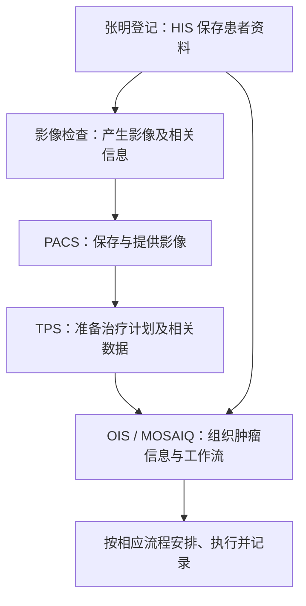

# 01｜跟着一位患者理解医院软件与 DICOM

这一章先解决三个问题：放疗是什么？医科达的软件在什么环节工作？为什么医院需要 DICOM？患者“张明”、医院和所有编号均为虚构。

## 一、先补最少的医学背景

先解释“临床”：在本文里，你可以把它理解为围绕患者开展诊断、治疗等活动。“临床系统”就是支持这些活动及其信息流的软件。它不是某一种固定产品，而是一类业务系统的统称。

### 1. “放疗”在做什么

放疗是“放射治疗”的简称，是使用辐射治疗肿瘤的一类方法。为了理解本岗位，你可以先看外照射这个例子：设备从体外向身体某个部位照射，治疗团队需要考虑目标区域，以及周围正常组织。

这里有两个容易混淆的事情：**拍影像用于了解身体内部情况；放疗用于治疗。**两者都可能涉及辐射，但目的和使用方式不同。CT 是一种影像检查，可以帮助观察内部结构；它不等于已经完成放疗。

这就引出软件问题：医生不能只拿到一张照片就直接开始治疗。相关人员还需要明确目标区域、准备治疗计划、检查和审核计划，再安排实际执行。你作为软件开发者，关心的是这些信息怎样准确流转和记录。

### 2. “计划、预约、执行”为什么是三件事

用熟悉的开发语言理解：计划描述“准备怎样做”；预约描述“安排什么时候做”；执行记录描述“实际发生了什么”。三者不能混成一个状态。

例如系统显示“张明明天 10 点有治疗预约”，只能说明排程安排了这个时间。患者可能改期，设备可能临时不可用，所以不能仅凭预约存在，就把治疗记录标记为“已完成”。

同样，计划文件已经导入，也不自动意味着计划已经被批准使用。这里涉及的批准由工作流和有权限的人员决定，接收接口只负责自己那一步。

### 3. 常见人员先认识三类

你可能与医生、医学物理师、治疗执行人员的工作流打交道。入门可以这样理解：医生关注治疗目标和患者情况；医学物理师参与计划、物理技术和质量相关工作；治疗执行人员按相应流程参与设备操作与记录。各机构具体分工可能不同。

对软件开发的启发是：**同一份数据可能由不同角色查看、修改和批准。**“能登录”不等于“能执行所有操作”，权限、状态变化和操作记录都要与业务要求一致。

## 二、张明从登记到治疗，软件在做什么

### 第一步：登记——医院要知道“他是谁”

张明到 A 医院登记，系统给他一个患者编号 `P0001`，保存姓名等资料。医院层面的业务系统常被称为 **HIS**，中文是医院信息系统。

此时一个常见需求是：肿瘤科的软件也需要知道张明是谁，避免工作人员重新输入一遍。所以两个系统需要交换患者资料。下一章的 HL7 v2 就可以用来理解这种消息交流。

**开发者关注：**编号来自哪里？同名患者如何区分？信息更新后哪些系统要同步？

### 第二步：影像检查——保存一组带身份和位置的数据

故事里，张明接受了一次 CT 检查。为了理解数据，可以想象检查产生了一叠不同位置的断层图像：每张展示身体内部的一个截面，把它们放在正确位置，软件才能理解空间关系。

这批影像需要保存和查询，常由 **PACS** 负责。中文全称是“影像归档与通信系统”，先把它记作“医院影像资料库及其传送服务”。

**开发者关注：**影像属于哪个患者、哪次检查？是否完整？另一套软件怎样获取？

### 第三步：准备计划——用影像和其他资料规划治疗

相关人员基于影像等资料准备治疗计划。这个环节会用到 **TPS**，也就是治疗计划系统。医科达的 Monaco 是 TPS 产品的例子。

用软件视角看，这里会出现几类数据：影像；目标区域和需要关注的正常组织的轮廓；计划参数；相关剂量分布。后面解释 DICOM 放疗对象时会用到它们。

**开发者关注：**计划参考了哪组影像？哪个版本？相关数据是否对应？

### 第四步：协调工作——把资料、进度和记录联系起来

肿瘤治疗通常涉及多个人、多项任务和持续的记录，需要一个面向肿瘤业务的信息系统协调。这类系统叫 **OIS**，即肿瘤信息系统。JD 提到的 **MOSAIQ** 就是你需要了解的产品。

入门时可以把它理解为“围绕肿瘤患者组织信息和工作流的软件”：不同人员需要知道资料是否齐全、任务到哪一步、排程如何、相关记录是什么。

医科达官方将 MOSAIQ 放在肿瘤工作流和信息管理的语境中。**TPS 的计划工作与 OIS 的信息/工作流管理有区别，也可以相互集成。**实际岗位负责其中哪个模块，要向团队确认。

### 第五步：执行与记录——保存“实际发生的事”

故事中计划通过相应审核后，张明按排程接受治疗。软件需要按实际工作流保存执行相关记录，供后续查看和协作。

这时开发者可以问：预约改期了，记录是否还能关联正确？新计划替代旧计划后，历史记录是否仍能找到当时的版本？谁修改了状态，是否有记录？这些问题与你在普通业务系统中处理状态、版本、审计的经验有关。

### 用一张图记住系统分工



这是一张教学职责图。实际系统之间的连接和时间顺序会因医院而异。

**第一次只记三句：PACS 帮助管理影像；TPS 支持治疗计划；OIS 帮助组织肿瘤信息与工作流。**

## 三、DICOM：为什么不能只发一张图片

### 1. 先想象没有统一标准会怎样

PACS 把一张图发给 TPS，文件名是 `zhangming.png`。你能看到图，但还有很多问题没有答案：

- 这是哪个张明？同名患者怎么办？
- 这是上个月还是今天的检查？
- 这张图在身体里的哪个位置？方向是什么？
- 图上一个像素对应实际多长距离？
- 是否还有同一次检查的其他图？

普通图片文件加上一个名字，不能可靠解决这些问题。医学影像交换需要把相关身份、检查、空间等信息一起表达。

### 2. DICOM 提供大家约定好的表达和交流方式

**DICOM 是医学影像及相关数据通信与管理的标准。**可以把它理解为医院影像系统之间约定的“共同语言”：不只是看见图，还要知道图的身份和含义，且知道怎样交换。

“影像数据＋相关信息”是方便入门的理解。实际 DICOM 还涉及对象模型、文件和通信服务；有些对象承载轮廓、计划等数据，不是照片。

对 Java 开发者可以类比：如果一条订单消息只有商品图片，没有订单 ID、商品 ID 和数量，下游无法可靠处理。医学影像也需要相应上下文，只是还多了空间等领域信息。

### 3. 用文件夹类比理解三个层次

```text
张明（患者）
└─ 10 月 7 日的 CT 检查（Study，检查）
   ├─ 一组图像（Series，序列）
   │  ├─ 一个图像对象（Instance，实例）
   │  └─ 另一个图像对象
   └─ 另一组图像（另一个 Series）
```

| 类别          | 常见字段                | Tag 示例                  | 作用                     |
| ------------- | ----------------------- | ------------------------- | ------------------------ |
| 患者信息      | PatientName             | `(0010,0010)`             | 患者姓名                 |
|               | PatientID               | `(0010,0020)`             | 患者编号                 |
| 检查信息      | StudyInstanceUID        | `(0020,000D)`             | 唯一标识一次检查 Study   |
|               | StudyDate               | `(0008,0020)`             | 检查日期                 |
| 序列信息      | SeriesInstanceUID       | `(0020,000E)`             | 唯一标识一个 Series      |
|               | Modality                | `(0008,0060)`             | CT / MR / PT 等          |
| 图像/空间信息 | SOPInstanceUID          | `(0008,0018)`             | 唯一标识这个 DICOM 对象  |
|               | InstanceNumber          | `(0020,0013)`             | 该图像在序列里的编号     |
|               | ImagePositionPatient    | `(0020,0032)`             | 图像在患者坐标系中的位置 |
|               | ImageOrientationPatient | `(0020,0037)`             | 图像方向                 |
|               | PixelSpacing            | `(0028,0030)`             | 一个像素实际对应多少 mm  |
| 像素数据      | Rows / Columns          | `(0028,0010)/(0028,0011)` | 图像高宽                 |
|               | BitsAllocated           | `(0028,0100)`             | 一个像素占多少 bit       |
|               | PixelData               | `(7FE0,0010)`             | **真正的图像像素数据**   |


这像“患者文件夹 → 检查文件夹 → 一组资料 → 具体对象”，用于理解层次，实际不是靠文件夹名识别。

**UID** 是唯一标识符，入门记作对象的唯一编号。检查、序列和实例有各自的 UID。重命名文件不会改变对象身份，两个文件名不同也可能是同一对象的重复传送。实际一个图像对象也可以包含多帧，不必死记“一张切片就是一个实例”。

第一次掌握“患者、检查、序列、对象不是同一级”就够了。SOP Class UID、编码语法等放到进阶阅读。


### C# 协议 API｜用 fo-dicom 真正读取文件

依赖 fo-dicom 5.2.6，命名空间 FellowOakDicom 与 FellowOakDicom.Imaging。初始化与自动生成测试文件见[协议 API 实战](07-CSharp医学协议API实战.md)。

```csharp
var file = DicomFile.Open(filePath);
var dataset = file.Dataset;

string patientId = dataset.GetSingleValueOrDefault(DicomTag.PatientID, "未提供");
string studyUid = dataset.GetSingleValue<string>(DicomTag.StudyInstanceUID);
Console.WriteLine($"患者号：{patientId}");
Console.WriteLine($"检查 UID：{studyUid}");

var pixelData = DicomPixelData.Create(dataset);
Console.WriteLine($"图像尺寸：{pixelData.Width} × {pixelData.Height}");
Console.WriteLine($"帧数：{pixelData.NumberOfFrames}");
Console.WriteLine($"第一帧字节数：{pixelData.GetFrame(0).Data.Length}");
```

DicomTag 是标准字段常量；Dataset 是实际文件解析后的数据集。测试输出为 P0001、2×2、1 帧、4 字节。GetFrame 访问像素帧，本例是未压缩合成小图，实际显示还需要对应解码和渲染。


## 四、放疗的三个 DICOM 对象，用“底图、圈线、方案、分布图”理解

RT 是 Radiotherapy，即放疗。下面是经典放疗对象的入门示例。

### 1. RTSTRUCT：在相关影像上定义结构和轮廓

故事中，相关人员需要表达哪些区域是目标、哪些是需要关注的正常组织。可以想象在影像上画轮廓，但软件保存的是结构和轮廓等数据，包含位置及引用信息。

**RTSTRUCT** 可以先理解为“**告诉其他系统：这些区域在哪里，以及它们对应什么相关影像/空间**”。它不是简单将圈线烙到 JPG 上。

### 2. RTPLAN：表达计划相关信息

**RTPLAN** 可以先理解为“**治疗计划这份方案的数据表达**”，描述相关计划信息。它需要与相应患者和其他数据保持正确联系。

你不需要在入门面试中解释复杂的束参数。重点是：计划有身份和相关上下文，拿错患者或拿错版本，即使文件格式没错也可能造成错误。

### 3. RTDOSE：表达剂量相关数据

**剂量**可以先理解为辐射能量在组织中的吸收量这一类信息。计划评估需要关注不同位置的剂量情况。**RTDOSE** 承载相关剂量数据，部分数据可以像三维分布图一样被显示。

不要把它和 CT 混为一谈：CT 帮助观察身体内部结构，剂量分布描述相关辐射剂量情况。入门不需要学习公式或自行判断计划好坏。

### 4. 为什么要强调“引用关系”

张明上个月和本月各有一组影像。系统收到一份轮廓数据，它是基于上个月影像准备的。如果仅因为“都是张明”就把它叠到本月影像上，位置可能不对应。

所以软件需要看对象中明确关联的信息，而不是按姓名、文件名或到达顺序拼接。这和数据库外键的思路类似：一条明细属于哪个主记录，必须明确。

入门可把关系记成：**底图是哪组？圈线依据什么？计划关联哪些资料？剂量数据对应什么上下文？**具体对象引用并非所有场景都固定一条链，实施时要查看字段和规则。


### C# 协议 API｜读取 RTDOSE 中的计划引用

对于具有相应序列的放疗对象，使用 fo-dicom 的 Sequence API。dataset 是当前对象数据集。

```csharp
if (dataset.TryGetSequence(DicomTag.ReferencedRTPlanSequence, out var plans))
{
    foreach (var item in plans.Items)
    {
        string planUid = item.GetSingleValue<string>(DicomTag.ReferencedSOPInstanceUID);
        Console.WriteLine($"引用的计划 UID：{planUid}");
    }
}
```

TryGetSequence 检查序列是否存在，Items 提供序列中的子数据集，ReferencedSOPInstanceUID 明确指出引用目标。完整项目已用合成引用片段运行，输出 2.25.2001；它不是完整 RTDOSE。具体引用要求按对象条件判断。


## 五、一个故障例子：文件收到了，为什么还不能使用

教学系统收到张明的计划相关文件，却发现它引用的一份影像资料还没到。网络传输成功，文件也保存在服务器上，但下游还无法按要求处理完整数据。

这个例子说明“成功”有层次：

```text
网络能连通 → 数据收到了 → 内容能够解析 → 关联资料齐全
            → 满足业务规则 → 进入相应工作流
```

如果数据库只有一个 `success=true`，你可能无法判断卡在哪一步。作为开发者，应按需求区分接收、处理和业务状态，保存错误原因，避免让使用者误以为全部完成。

**面试回答可以这样讲：**

> 我理解 DICOM 不只是医学图片格式，还支持医学影像及**相关数据交换**。例如放疗可能涉及**影像**、**结构轮廓**、**计划**和**剂量**数据。我会关注它们是否属于**正确患者**、是否关联**正确资料**，以及数据接收成功和业务可以使用是不是同一回事。遇到导入失败，我会先查看输入、日志和接口约定，区分传输、数据解析、引用缺失还是业务状态问题。

## 六、三道小练习，直接看答案纠错

**题 1：把张明的计划文件上传成功后，能否自动标记治疗已完成？**

答案：不能。上传是数据接收；治疗完成是实际执行后的业务记录，中间还有计划处理和相关工作流。

**题 2：两个文件名字不同，就一定是不同影像吗？**

答案：不一定。文件名可以修改，要看对象标识及约定的重复处理规则。

**题 3：PACS、TPS、MOSAIQ 用一句话各怎么介绍？**

答案：PACS 管理影像归档与通信；TPS 支持治疗计划；MOSAIQ 属于肿瘤信息和工作流管理产品。

## 七、第一次可以跳过的细节与来源

现在不必背 C-MOVE/C-GET、SOP 类型、坐标转换或剂量缩放公式。需要时看[原详细版](进阶参考/01-临床系统与DICOM学习.md)。

CT 与相关人员背景：[RSNA/ACR 的 CT 介绍](https://www.radiologyinfo.org/en/info/bodyct)、[放疗介绍](https://www.radiologyinfo.org/en/info/intro_onco)。放疗基本概念：[美国国家癌症研究所 NCI](https://www.cancer.gov/about-cancer/treatment/types/radiation-therapy)。MOSAIQ 定位：[医科达 Oncology Care](https://www.elekta.com/products/oncology-informatics/elekta-one/oncology-care/)。DICOM 定义：[DICOM 标准范围](https://dicom.nema.org/medical/dicom/current/output/chtml/part01/chapter_1.html)。放疗对象与产品区别的具体来源见[官方来源文档](05-官方来源与事实边界.md)。
