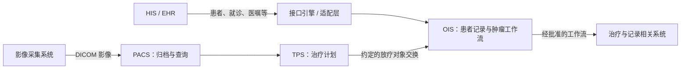

> 进阶参考：2026-10-02 原详细版。首次学习请先阅读[小白速学路线](../00-阅读指南与学习路线.md)。

# 临床系统与 DICOM：从系统地图到放疗对象

## 1. 先看业务角色，再看协议

| 术语 | 全称/中文 | 学习时怎样理解 |
|---|---|---|
| HIS | Hospital Information System，医院信息系统 | 医院级业务入口；实际模块范围因医院而异 |
| EHR/EMR | Electronic Health/Medical Record，电子健康/病历记录 | 患者记录及相关工作流；两者范围不能在每家机构简单画等号 |
| RIS | Radiology Information System，放射科信息系统 | 放射检查的申请、排程、报告等业务 |
| PACS | Picture Archiving and Communication System，影像归档与通信系统 | 影像归档、检索、分发；不是一般文件网盘 |
| OIS | Oncology Information System，肿瘤信息系统 | 肿瘤患者记录与工作流协作；本岗位对象为 MOSAIQ |
| TPS | Treatment Planning System，治疗计划系统 | 支持治疗计划设计和相关计算；与 OIS 职责不同 |
| MPI | Master Patient Index，主患者索引 | 管理跨系统身份关联，帮助处理同人多号与身份冲突 |

表格是通用业务词汇表，不是 Elekta 产品架构。Elekta 官网公开说明其 OIS 通过 HL7 等标准连接其他 EHR 工作流；这能证明互操作性是业务主题，不能证明团队的每个模块、接口版本或部署方式。[Elekta 互操作性](https://www.elekta.com/products/oncology-informatics/interoperability/)

下面是理解数据职责的简化教学图，箭头不表示每个医院都这样部署，也不表示每条通路都有三类标准。



接口引擎可以负责路由、格式映射、排队、监控和重试，但它不能凭转换规则替代临床语义判断。一个状态映射错误，即使网络全部成功，也可能让下游理解错误。

## 2. 放疗流程只学软件视角

用“患者登记 → 相关影像 → 计划准备与审核 → 排程/执行记录 → 后续记录”理解信息流即可。这里只是学习框架；实际流程、角色授权、审核规则由临床和产品团队定义。

开发者关注的对象通常包括患者、就诊、影像检查、计划、版本、批准状态、预约、执行记录。最需要问清楚的是：哪个系统负责主数据？更新和撤销由谁发起？什么条件下下游可使用？历史版本怎样保留？

例如“计划文件已收到”和“计划已获批准可供后续流程使用”是不同状态。接收接口不应自己推导临床批准状态。

## 3. DICOM 的核心不是文件后缀

DICOM 覆盖医学影像信息及相关数据的通信与管理，包括网络通信、数据语义和介质文件等内容。因此“会打开 .dcm”不足以证明会做 DICOM 集成。[DICOM PS3.1 范围](https://dicom.nema.org/medical/dicom/current/output/chtml/part01/chapter_1.html)

先掌握如下信息层次和身份差异；更具体定义见[来源文档 DICOM 部分](../05-官方来源与事实边界.md)。

```text
Patient（患者：业务身份须结合机构/标识域）
└─ Study（检查/研究：Study Instance UID）
   └─ Series（序列：Series Instance UID）
      └─ Instance（对象实例：SOP Instance UID）
```

| 信息 | 意义 | 容易混淆的地方 |
|---|---|---|
| Patient ID / Issuer | 患者标识及签发域 | 两家医院的相同编号不能直接认定同一人 |
| Study/Series Instance UID | 检查与序列的对象身份 | 不能用文件目录或展示名称替代 |
| SOP Class UID | 对象属于什么标准类型 | 是“类型”，不是某一份对象的编号 |
| SOP Instance UID | 某个对象实例的身份 | 不是患者 ID，也不等于数据库自增主键 |
| Transfer Syntax | 编码/传输语法 | 双方网络可连通，也可能编码不兼容 |
| Frame of Reference UID | 空间参考系关联 | 同一患者不保证两个影像/结构能直接空间叠加 |

SOP 可理解为 Service-Object Pair。网络通信常用 SCU（服务使用者）和 SCP（服务提供者）描述某项服务的角色；一个系统在不同服务上可以有不同角色。AE Title 标识应用实体，不是登录账号。端点、角色、支持的 SOP Class 和 Transfer Syntax 都应核对双方能力声明。

## 4. 放疗为什么不仅交换 CT 图片

| 对象 | 教学用途 | 开发者主要核对什么 |
|---|---|---|
| CT 等影像 | 相关影像数据 | 检查/序列/实例身份，几何信息与完整性 |
| RT Structure Set（常称 RTSTRUCT） | 感兴趣区域、轮廓及关联数据 | 引用的影像、结构编号、空间参考关系 |
| RT Plan（RTPLAN） | 治疗计划相关信息 | 对象引用、计划身份/版本、约定的处理状态 |
| RT Dose（RTDOSE） | 剂量数据 | 关联计划、剂量单位与缩放、网格空间信息 |

以上是传统 RT 对象入门；DICOM 放疗对象不止这些，不能据此宣称支持全部放疗交换。官方定义：[RT Structure Set](https://dicom.nema.org/medical/dicom/current/output/chtml/part03/sect_A.19.html)、[RT Plan](https://dicom.nema.org/medical/dicom/current/output/chtml/part03/sect_A.20.html)、[RT Dose](https://dicom.nema.org/medical/dicom/current/output/chtml/part03/sect_A.18.html)。

教学关系可记作“影像被结构引用，计划可能引用结构，剂量可能关联计划”，但具体关系须看对象字段，不能靠到达顺序拼接。RT Dose 数值也不能简单当作原始像素数值就是 Gy；应检查单位与 Dose Grid Scaling 等字段。具体几何/剂量校验交由经过验证的实现与领域规则承担。

## 5. 网络服务与 DICOMweb

| 服务 | 用途 | 追问时说清楚 |
|---|---|---|
| C-ECHO | 验证通信服务响应 | 成功不代表影像对象能存储或业务可用 |
| C-STORE | 传送并存储对象 | 接收状态不等于对象引用完整、长期保存或临床批准 |
| C-FIND | 查询 | 返回匹配信息，不是把全部影像数据下载下来 |
| C-MOVE | 请求检索并送往指定目的地 | 对象通常通过另外的 C-STORE 关联传送，要检查目的 AE 与网络 |
| C-GET | 请求检索 | C-STORE 子操作使用同一关联；仍需协商相关能力 |
| DICOMweb | Web 方式的相关服务 | 常见 QIDO-RS 查询、WADO-RS 获取、STOW-RS 存储 |

服务定义与原始链接见[来源文档](../05-官方来源与事实边界.md)。无需先背命令参数，优先理解查询、传送、存储成功和业务就绪分别发生在哪一步。

## 6. 故障题：计划收到了，但系统不能使用

**回答顺序：**核对双方版本和能力声明 → 检查传输响应与拒绝原因 → 确认患者关联和 SOP Instance 身份 → 检查所引用影像/结构是否齐全 → 核对空间参考、支持字段和业务状态 → 形成复现与回归证据。

一份对象可成功保存，却因为引用对象未到达而处于待补齐状态。学习设计中可将“已接收、待依赖、已验证、冲突隔离”分别记录；不要只用一个 Success 布尔值概括所有阶段。

同一 SOP Instance UID 再次到达时，应按实现契约处理重复；若发现同 UID 内容冲突，不静默覆盖。哈希能用于学习实验识别输入差异，但不同编码不必然代表临床语义不同，生产判断应使用团队约定规则。

**自测：**如果文件名不同、SOP Instance UID 相同，你如何判断重复？如果患者相同、Frame of Reference 不同，为什么不能直接叠加？如果 C-ECHO 成功、C-STORE 失败，下一步查什么？
