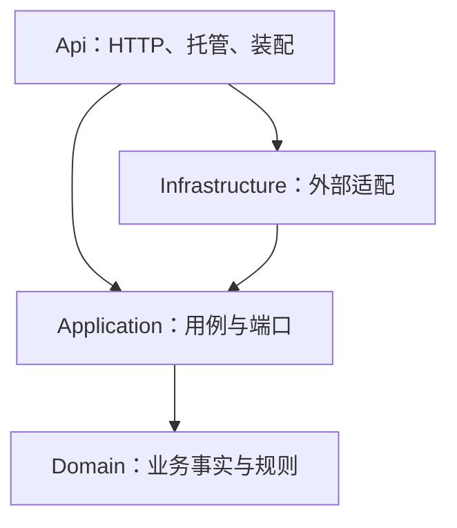

# 02：分层、依赖方向与类设计

## 1. 先画依赖图

箭头表示编译依赖，而不是运行时调用顺序。运行时 Application 会调用数据库适配器，但只认识自己定义的接口；具体类由 Api 装配。这就是依赖反转在本项目中的实际含义。

Api 引用 Infrastructure 是组合根的职责。端点文件不因此获得随意使用 DbContext 的理由。基础设施注册和健康检查可以知道数据库，业务端点只调用应用用例。`ArchitectureTests` 验证领域和应用程序集不引用 EF Core、ASP.NET、ImageSharp 或 Infrastructure。

## 2. 各目录承担什么职责

| 程序集 / 目录 | 内容 | 不应出现的内容 |
|---|---|---|
| Domain/Model | 图像、ROI、任务、测量、修订等事实；分析状态转换 | HttpContext、数据库连接、外部 HTTP 调用 |
| Domain/Reviews | 复核允许条件与版本规则 | 行锁 SQL、HTTP 状态码 |
| Domain/Quantification | 分类、统计、距离、Ki-67 及区域比较的纯计算 | 文件系统和数据库读取 |
| Application/Workspace | 项目、图像、区域及导入用例 | EF 查询、TIFF 解码 |
| Application/Analysis | 建单、重试、单次任务执行编排 | 轮询延迟、连接字符串、托管生命周期 |
| Application/Reviews | 在一致性范围内检查并追加复核 | MySQL 的 FOR UPDATE 细节 |
| Application/Results | 固定复核版本、重建有效判定、组织导出和比较 | PNG 解码或像素绘图 |
| Application/Ports | 持久化、推理、导入、产物和导出的能力接口 | IQueryable、DbSet、MySQL 事务类型 |
| Infrastructure/Persistence | DbContext、仓储、迁移、锁与事务 | 重新定义 Ki-67 是否可复核 |
| Infrastructure/Inference | Python 协议、结果契约验证 | 人工复核流程 |
| Infrastructure/Storage、Exports | 本地文件、导入发布、PNG/ZIP 导出 | 决定复核版本是否有效 |
| Api/Endpoints | HTTP 绑定、文件上传、状态码、返回形状 | 修改任务状态、数据库锁 |
| Api/Hosting | 后台宿主、异常映射 | 量化算法 |

## 3. 为什么不是每张表一个服务、每个类一个接口

`IWorkspaceRepository` 面向项目与图像工作区的实际读写需求；`IAnalysisRepository` 面向任务生命周期与原子发布；`IResultRepository` 面向复核与快照读取。它们没有暴露任意 `Find(Expression)` 或 `Save<T>`，调用方无需学习 EF 的执行时机和追踪规则。

这里的接口有明确用途：隔离外部 I/O，方便替换实现、模拟失败、测试用例。`AnalysisService`、`ReviewService` 等具体用例没有额外的同名接口，避免仅为依赖注入增加无意义跳转。纯量化函数也没有强行变成可注入服务。

这些接口仍有代价：新增查询要同时修改接口与实现。当前规模可以接受，因为它换来了 Application 对数据库库的零依赖。更大规模下应按业务功能继续拆分，不能让一个仓储逐渐长成全系统的万能入口。

## 4. AnalysisRun 为什么值得拥有行为

重构前状态可由 HTTP handler、worker 和 SQL 各自赋值。一个类即便叫“领域实体”，若外部能随意写 `Status = "Succeeded"`，也不能保证业务规则。

现在状态、尝试次数、完成时间和错误使用私有 setter，调用者只能通过 `Start`、`Succeed`、`Fail`、`Retry`、`RecoverInterrupted`。创建后不应变化的身份和方案使用 init 属性。对象表达合法转换，数据库适配器负责并发时读取最新状态并原子保存。二者缺一不可：封装 setter 不会自动提供跨请求并发安全。

当前仍允许对象初始化器创建任务，这方便 EF 映射与测试；正常建单入口使用 `AnalysisScheme.Create`，统一校验图像、ROI、模型和阈值。若后续出现更多创建入口，应进一步收紧构造方式，而不是复制校验。

## 5. 为什么保留一些务实的数据形态

为了保持数值和存储契约，阈值、轮廓与采集资料仍以 JSON 保存，领域内保留 BCL 的 System.Text.Json 辅助方法。这是迁移成本与纯粹性之间的取舍：领域不引用 Web 或 EF，但不是完全不含序列化知识的理想模型。

统计结果仍有部分 object 形状与匿名值。它们维持现有导出格式，未来稳定扩展时可逐步替换为明确记录类型。不能把“已经四层”理解为所有设计债务都消失了。

`OperationFailure` 使用语义分类，例如 Invalid、Conflict、Dependency，不携带 HTTP 数字；Api 的 `ExceptionHandling` 才负责映射成 400、409、502。这样同一个用例未来可以从 CLI 或其他宿主调用。

## 6. 配置和装配是最后一层

`Program.cs` 现在只负责宿主配置、依赖装配、显式初始化和端点注册。`AddInfrastructure` 绑定应用接口与真实适配器；生命周期规则是：FileStore 无可变请求状态，可以 singleton；DbContext、仓储和应用用例使用 scoped；后台 worker 每轮建立新 scope，避免把 scoped DbContext 长期存放在单例中。

Python HttpClient 由工厂创建并设置 90 秒超时。超时是等待上限，并不保证远程 Python 已停止计算。这个细节会在一致性章节解释。
