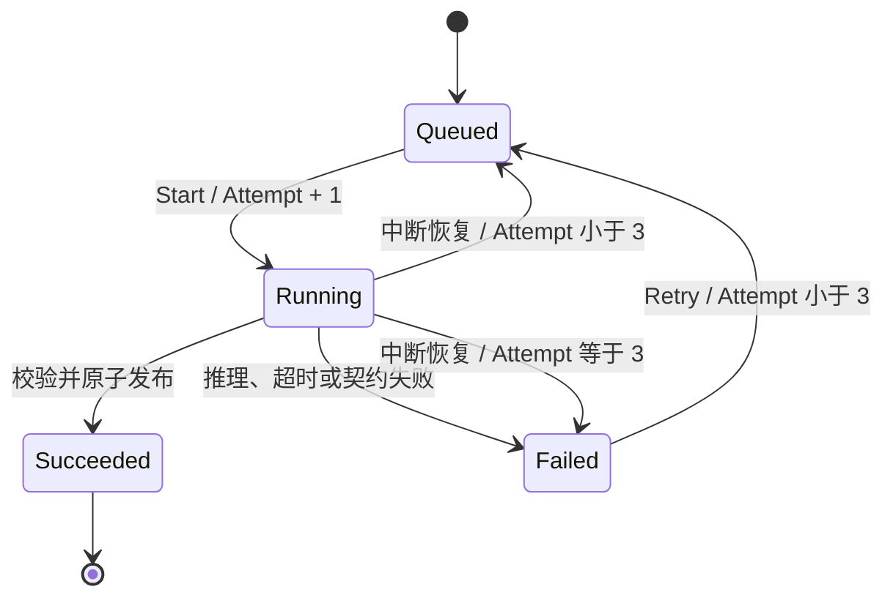

# 04：任务、事务与失败处理

## 1. 状态机与尝试预算

人工重试和重启恢复共用三次预算。创建后的第一次执行算第一次；用户点击重试只排队，不马上增加次数。普通推理失败不会无限自动重试，需要用户排障后操作。中断恢复会在预算内自动重新排队。

`StartedAt`、`FinishedAt` 描述当前或最近一次状态；本系统没有独立的尝试历史表。若需要每次耗时与错误审计，应新增 Attempt 记录，而不是误把这些字段当成完整执行历史。

## 2. 为什么领取也要有事务

`ClaimNext` 使用 MySQL `FOR UPDATE SKIP LOCKED` 锁定待执行任务，在事务内调用 Start 并保存。这样“看到 Queued”和“改为 Running”是一个原子动作。独立的先查后改容易重复领取。

即使有这个锁，本版本也仅支持单 worker。启动恢复会扫描 Running 并重新排队，它无法判断另一个实例是否仍在工作。多实例必须使用带所有者和到期时间的租约，并在完成时检查执行代次；不能只把容器数量改为 2。

## 3. 不在事务内等待 Python

推理可能耗时数十秒。若持有数据库锁等待 HTTP，会扩大锁占用和故障影响。这里把事务分成短阶段：

1. 事务一：领取任务并记录 Running、Attempt。
2. 无数据库事务：执行推理，验证文件及测量契约。
3. 事务二：重新锁任务，核对仍为 Running 且 Attempt 相同，插入细胞和产物索引，标记 Succeeded，一起提交。

同一个旧响应晚到时，如果任务已经完成或尝试代次不符，发布会被忽略，不会删除或替换原有细胞。原版本 worker 的“先删除再重建结果”逻辑已移除。失败更新也使用相同的状态和代次检查，避免数据库提交结果不明时把已成功任务改成失败。

真实 MySQL 测试故意制造产物外键错误，验证整个发布事务回滚：不会留下细胞已插入但任务失败的半成品。

## 4. 超时不等于远程取消

.NET 的 90 秒 HttpClient 超时只停止本次等待；Python 的同步计算可能继续。重试使用相同 runId 和固定输入，Python 在进程内串行执行，并核对已有 manifest 的图像、assay、ROI 和模型身份；已完成的匹配结果可以复用。

这是“可重复执行计算、只发布一次结果”的工程策略，不是分布式 exactly-once。若未来算法不再确定、输入可变、远程服务不支持幂等，必须重新设计执行协议。

## 5. 文件和数据库不共享事务

导入先写 staging，调用 Python 校验和生成预览，再原子移动到 images 目录，最后保存元数据。普通失败会清理 staging 或已发布目录；进程被强制终止可能遗留孤立目录。数据库提交发生网络中断时，客户端不能完全确定提交结果；补偿前会用独立的短超时查询确认记录不存在，若仍无法查询则保留文件供后续对账，避免删除可能已提交记录所引用的文件。

分析文件由 Python 在临时目录生成后发布，.NET 校验成功再建立数据库索引。如果数据库提交失败，文件可能已经存在；后续重试会复用符合输入身份的缓存。不要人工覆盖成功任务目录，也不要在没有核对引用的情况下批量删除文件。

真正的生产文件管理可以增加导入意图记录、发布状态、延迟垃圾回收与对账任务。本轮保留明确的本地卷方案，没有假装跨资源原子性已经解决。

## 6. 复核的并发语义

`WithLockedRun` 先清除旧跟踪对象，再开启事务并锁任务行。在锁内读取当前版本、检查 BaseReviewVersion、验证对象与质控、创建修订。两个基于版本 0 的并发请求最多有一个成功，另一个得到 REVIEW_CONFLICT。数据库唯一索引 `(RunId, Version)` 是最后一道约束。

为保持原有契约，v1 identity 复核允许不提供 BaseReviewVersion；其含义是按到达顺序追加，而不是拒绝所有陈旧编辑。v2 和 Ki-67 复核必须带版本。UI 提交明确版本更容易解释冲突。

这里记录的是复核内容、时间、版本和原因，没有经过认证的操作者身份。系统中“local-user”只是当前无认证模式说明，不能用作安全审计证据。

## 7. 快照的一致性

`ResultService.Snapshot` 在 RepeatableRead 事务内读取测量及修订，把“最新”固定为一个版本；ComparisonService 在同一个快照事务内读取 A 与 B，嵌套读取复用当前事务。导出基于解析后的快照，不会在写到一半时换成新的复核版本。

成功测量与产物索引不可变，是导出可以在快照读取结束后继续访问文件的前提。持久卷若丢失或被外部修改，数据库快照无法修复它；缺失文件会返回明确错误，备份必须同时考虑数据库与产物卷。
