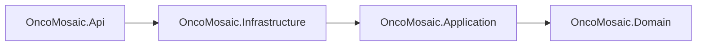
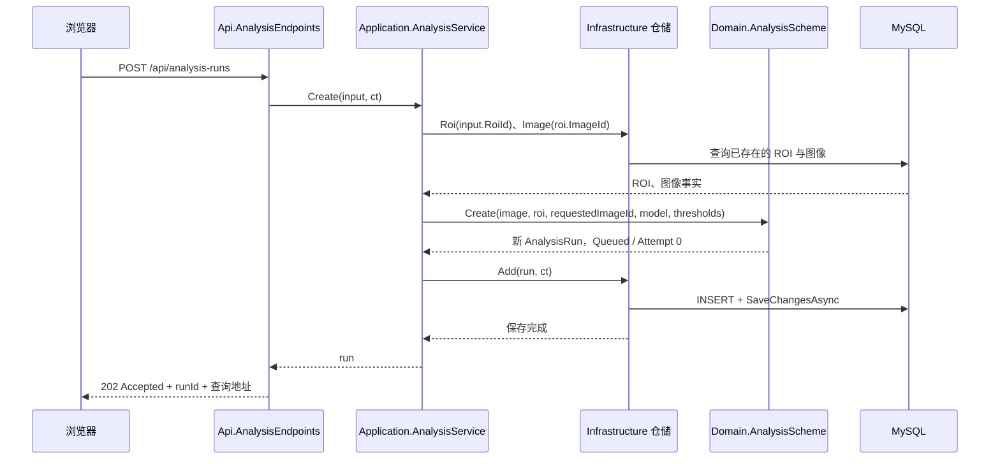
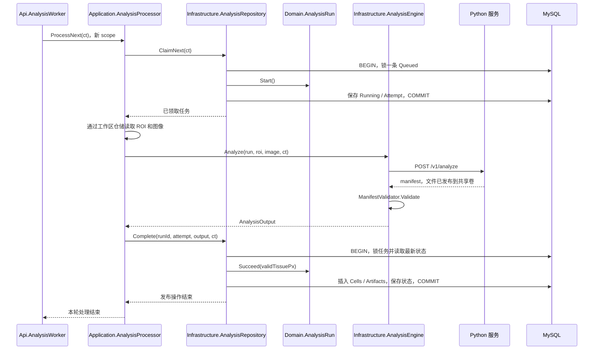

# 08：沿着实际代码理解四层架构与分析任务流转

本文是对当前实现的源码导读，回答三个问题：每层负责什么，为什么这样拆，一次分析如何从浏览器请求变成可读取的结果。以下链接均指向仓库真实文件；代码片段节选自当前实现，流程示例中的任务 ID、数量等为说明用途。

建议阅读顺序：先看第 1–3 节建立结构与对象关系，再沿第 4–8 节跟踪一次成功任务，最后看第 9–12 节理解失败、设计取舍和测试。已有设计原则与开发路线分别见 [分层设计](02-architecture.md)、[开发顺序](03-development.md)；本文重点是把这些原则对应到具体调用。

## 1. 这四层首先是四个程序集，不是四个独立服务

后端只有一个 .NET API 宿主。四个项目共同编译并发布到同一个 API 应用中，后台 worker 也在这个进程里运行。MySQL 和 Python 是外部进程，React 是浏览器端应用。

直接项目引用如下，箭头表示 `.csproj` 中的 `ProjectReference`：



查看 [Api 项目](../../backend/OncoMosaic.Api/OncoMosaic.Api.csproj)、[Infrastructure 项目](../../backend/OncoMosaic.Infrastructure/OncoMosaic.Infrastructure.csproj)、[Application 项目](../../backend/OncoMosaic.Application/OncoMosaic.Application.csproj) 和 [Domain 项目](../../backend/OncoMosaic.Domain/OncoMosaic.Domain.csproj) 可以核对这条引用链。Api 通过传递引用也能使用 Application 和 Domain 类型。

这张图描述编译依赖，不能直接读成“每个请求先经过 Infrastructure 再到 Application”。运行时端点先调用应用用例，应用用例再通过接口调用具体数据库或推理实现。编译依赖与运行调用方向不同，正是后面要解释的依赖反转。

当前设计属于分层的模块化单体。四层不是四个业务限界上下文，也没有为每个功能建立完全独立的数据所有权。它主要解决职责混合和技术依赖扩散，不声称已经完成复杂领域的全面 DDD 建模。

## 2. 每层的责任，由它需要知道什么决定

| 层 | 核心问题 | 当前代表代码 | 不应承担的工作 |
|---|---|---|---|
| Api | 外界如何调用？进程如何运行？ | AnalysisEndpoints、Representations、AnalysisWorker、Program | 在业务端点中编写行锁 SQL、直接赋任务状态 |
| Application | 为完成一个用例，需要按什么顺序做哪些事？ | AnalysisService、AnalysisProcessor、ReviewService、ResultService | 知道 Python URL、DbSet、HTTP 状态码、PNG 编码细节 |
| Domain | 什么是合法的业务事实与状态变化？ | AnalysisRun、AnalysisScheme、ReviewPolicy、Quantification | 查询数据库、等待网络、创建后台线程 |
| Infrastructure | 如何通过具体技术读写、计算和发布？ | AnalysisRepository、AppDb、AnalysisEngine、ManifestValidator | 另写一套允许非法状态跳转的规则 |

### 2.1 Api：传输入口和进程宿主

[AnalysisEndpoints](../../backend/OncoMosaic.Api/Endpoints/AnalysisEndpoints.cs) 定义 URL、参数绑定、返回状态和响应位置；[Representations](../../backend/OncoMosaic.Api/Endpoints/Representations.cs) 把内部任务组织成前端需要的形状。例如实体属性叫 `Id`，响应字段叫 `runId`，内部 `ThresholdsJson` 被转换回 JSON 对象。

[Program](../../backend/OncoMosaic.Api/Program.cs) 是组合根：选择配置、注册对象、执行显式初始化、安装异常处理和映射端点。它知道 Infrastructure，因为总要有一个地方选择真实的数据库和推理适配器。这个依赖不意味着所有业务 handler 都应该使用 DbContext。

[AnalysisWorker](../../backend/OncoMosaic.Api/Hosting/AnalysisWorker.cs) 也在 Api，因为它依赖 .NET 的 `BackgroundService`、日志、scope 和进程停止信号。它解决“怎样持续运行处理器”，而不是“分析业务怎么完成”。因此 Api 在本项目里不仅是控制器目录。

### 2.2 Application：可被不同入口调用的用例

[AnalysisService](../../backend/OncoMosaic.Application/Analysis/AnalysisService.cs) 负责面向用户的建单、查询、重试和产物访问；[AnalysisProcessor](../../backend/OncoMosaic.Application/Analysis/AnalysisProcessor.cs) 负责一次后台处理。一个以用户命令为入口，一个以持久队列为入口，所以没有合并成万能 AnalysisService。

应用层读取必要事实，调用领域规则，再通过端口执行 I/O。它自己并不决定 `Failed → Queued` 是否合法，也不负责把 `FOR UPDATE` 拼进 SQL。用例编排不等于把全部业务规则放进一个 service。

### 2.3 Domain：拥有规则，而不只是承载属性

[AnalysisRun](../../backend/OncoMosaic.Domain/Model/AnalysisRun.cs) 的状态、尝试次数、错误和完成时间使用私有 setter，外部只能通过 `Start`、`Succeed`、`Fail`、`Retry`、`RecoverInterrupted` 改变它们。

例如 `Start` 不只是写入一个字符串，它同时检查旧状态和次数预算、增加次数、设置开始时间、清空旧错误。把这些步骤收在一个方法中，可以避免不同调用者漏做其中一项。

[AnalysisScheme](../../backend/OncoMosaic.Domain/Model/AnalysisScheme.cs) 根据图像面板、ROI、模型和阈值创建合法方案。[ReviewPolicy](../../backend/OncoMosaic.Domain/Reviews/ReviewPolicy.cs) 检查复核条件。[Quantification](../../backend/OncoMosaic.Domain/Quantification/Quantification.cs) 和 [Ki67Quantification](../../backend/OncoMosaic.Domain/Quantification/Ki67.cs) 实现纯计算。这些代码不需要知道请求来自浏览器还是命令行。

并非每个类都需要复杂行为。Artifact 主要是产物记录，Project 主要是组织信息；给它们增加空洞的基类和接口不会自动提升设计质量。AnalysisRun 有真实生命周期，才值得封装状态行为。

### 2.4 Infrastructure：实现外部能力，并阻止技术细节向内传播

[AppDb](../../backend/OncoMosaic.Infrastructure/Persistence/AppDb.cs) 表达 EF 模型、外键和唯一索引；[AnalysisRepository](../../backend/OncoMosaic.Infrastructure/Persistence/AnalysisRepository.cs) 实现领取、锁定和原子发布；[AnalysisEngine](../../backend/OncoMosaic.Infrastructure/Inference/AnalysisEngine.cs) 把应用层的一次“分析”翻译成 Python HTTP 调用与文件校验。

[ManifestValidator](../../backend/OncoMosaic.Infrastructure/Inference/ManifestValidator.cs) 需要打开 PNG、NPY、JSON 和文件路径，所以位于 Infrastructure。它执行的是外部协议接入校验，最终产出内部认识的 Cell 和 Artifact。业务规则与技术校验不必全部塞进 Domain：一个检查需要读取文件、理解二进制格式时，就已经涉及外部适配。

## 3. 对象如何接起来：接口、构造函数和生命周期

### 3.1 为什么 Processor 认识接口，却能调用 Python

[ExternalServices.cs](../../backend/OncoMosaic.Application/Ports/ExternalServices.cs) 中定义：

```csharp
public interface IAnalysisEngine
{
    Task<AnalysisOutput> Analyze(AnalysisRun run, Roi roi, TissueImage image, CancellationToken ct);
}
```

接口属于 Application，因为它描述“完成用例所需的能力”。Infrastructure 的 `AnalysisEngine` 实现它，应用层无需反过来引用 Infrastructure。

[DependencyInjection](../../backend/OncoMosaic.Infrastructure/DependencyInjection.cs) 把选择落到代码：

```csharp
services.AddScoped<IAnalysisRepository, AnalysisRepository>();
services.AddScoped<IWorkspaceRepository, WorkspaceRepository>();
services.AddScoped<IAnalysisEngine, AnalysisEngine>();
```

Processor 的主构造函数声明它需要什么：

```csharp
public sealed class AnalysisProcessor(
    IAnalysisRepository runs,
    IWorkspaceRepository workspace,
    IAnalysisEngine engine)
```

当容器创建 Processor 时，会提供上面注册的真实对象。Processor 没有 `new HttpClient()`、没有连接字符串，也没有自行选择 Python 实现。测试则可以直接传入会超时或取消的替身，不必启动 Python。

这里 `Task<T>` 表示异步操作的返回类型，不表示“每调用一次就创建专用线程”。任务持久化与后台调度来自仓储和 worker，不来自 C# 的 `async` 关键字。

### 3.2 为什么 worker 每轮创建 scope

API 请求天然拥有请求作用域，DbContext 和应用用例使用 scoped 生命周期。HostedService 通常随宿主长期存在，不能直接长期持有某个请求作用域的 DbContext。

因此 worker 每轮执行：

```csharp
using var scope = scopes.CreateScope();
var processor = scope.ServiceProvider.GetRequiredService<AnalysisProcessor>();
```

这一轮内的仓储共享同一 scoped AppDb；本轮结束后 scope 释放，下一轮重新创建。这样既能让复核等用例中的多个仓储共享事务，也不会让 worker 把跟踪对象积累一整天。

注意：**scope 的存活期不等于数据库事务的存活期**。某一轮 scope 可以跨越 HTTP 推理等待，但数据库事务只在领取和发布这两个短阶段存在。

## 4. 第一段流程：提交请求，保存分析意图

假设已有图像 I、ROI R，用户选择 v2 模型和四个阈值。请求体的说明性示例：

```json
{
  "imageId": "11111111-1111-1111-1111-111111111111",
  "roiId": "22222222-2222-2222-2222-222222222222",
  "modelVersion": "spectral-mif-sim-v2",
  "thresholds": { "panck": 0.35, "cd3": 0.35, "cd8": 0.35, "ki67": 0.35 }
}
```

这两个 GUID 必须替换为数据库中实际关联的图像和 ROI；示例不是可直接执行的演示数据。



### 4.1 HTTP handler 只表达传输语义

实际端点的核心片段：

```csharp
var run = await analysis.Create(input, ct);
return Results.Accepted($"/api/analysis-runs/{run.Id}", Representations.Run(run));
```

返回 202 表示任务已被接受并持久化，不表示 Python 已开始，也不表示分析成功。handler 没有启动临时线程，更没有等待数十秒的推理。

### 4.2 应用层读取事实，领域层判断是否合法

`AnalysisService.Create` 的完整主体很短：

```csharp
var roi = await workspace.Roi(input.RoiId, ct);
var image = await workspace.Image(roi.ImageId, ct);
var run = AnalysisScheme.Create(image, roi, input.ImageId, input.ModelVersion, input.Thresholds);
await runs.Add(run, ct);
return run;
```

这里从 `roi.ImageId` 读取图像，再与客户端传来的 `input.ImageId` 校验。数据库中的归属关系是事实，客户端不能通过同时传入两个无关 ID 改写它。

`AnalysisScheme.Create` 检查 ROI 与图像关系、受支持模型、阈值范围，以及 Ki-67 面板与模型/阈值组合。通过后创建 AnalysisRun，固定 RoiId、ModelVersion、AlgorithmVersion 和 ThresholdsJson。实体默认 `Status = "Queued"`，Attempt 默认 0，ID 在构造时生成。

### 4.3 队列在哪里

`AnalysisRepository.Add` 将实体加入 DbSet 并调用 SaveChangesAsync。没有额外的内存队列，也没有 RabbitMQ；数据库中状态为 Queued 的 AnalysisRuns 记录就是待处理队列。

因此请求结束后，任务仍然存在，后台 worker 可以从数据库继续处理。不过，**一次 HTTP 提交本身没有幂等键**：如果客户端超时后重新 POST，可能创建另一条新任务。后面讲的“幂等发布”针对同一个 runId，不代表重复提交会自动去重。

## 5. 第二段流程：后台领取并执行



这张图是正常成功路径。`Complete` 会在锁内检查状态与尝试代次；不满足时忽略迟到结果，而不是再次执行 Succeed。

### 5.1 Worker 负责“持续执行”，Processor 负责“执行一个”

worker 启动后先执行一次 `RecoverInterrupted`，随后不断调用 ProcessNext。没有任务时等待 1 秒；发生一般错误时记录日志、等待 2 秒，并在下一轮重新做恢复。宿主停止则退出循环。

Processor 的主要成功路径为：

```csharp
var run = await runs.ClaimNext(ct);
if (run == null) return false;

var roi = await workspace.Roi(run.RoiId, ct);
var image = await workspace.Image(roi.ImageId, ct);
var output = await engine.Analyze(run, roi, image, ct);
await runs.Complete(run.Id, run.Attempt, output, ct);
return true;
```

`true` 的准确含义是本轮领取并处理了一个任务；它不是业务成功状态的另一个权威来源。由于迟到发布可能被忽略，数据库中的任务状态仍是最终依据。

### 5.2 领取为什么需要 SQL 行锁

`ClaimNext` 的查询核心是以下参数化 SQL 的逻辑结构，模型值来自领域常量：

```sql
SELECT * FROM `AnalysisRuns`
WHERE `Status` = 'Queued'
  AND `ModelVersion` IN (...)
ORDER BY `CreatedAt`
LIMIT 1 FOR UPDATE SKIP LOCKED
```

它在事务内选取并锁定任务，再执行 `next.Start()` 和 SaveChangesAsync，最后提交。`FOR UPDATE` 保护读后修改，`SKIP LOCKED` 跳过已经被其他事务锁住的行。

若先查询再单独更新，两次领取可能都看到同一条 Queued。这里把选择和状态变更放在同一事务内，避免这一竞态。

### 5.3 谁决定 Attempt 加一

`AnalysisRun.Start` 中负责：

```csharp
Require(Status == "Queued", "只有排队任务可运行");
Require(Attempt < MaximumAttempts, "任务已达到最大尝试次数");
Status = "Running";
Attempt++;
StartedAt = DateTime.UtcNow;
```

仓储负责锁与保存，领域对象负责规则与字段协调。领域对象自己不能防止两个进程同时读旧值，行锁自己也不知道哪些状态转换有业务意义。正确性来自二者协作。

成功领取后事务已提交。接下来等待 Python 时不持有这把数据库行锁，避免把长耗时计算变成长事务。

## 6. 第三段流程：Python 计算、文件发布与结果校验

### 6.1 应用层的一次调用，基础设施层包含多步工作

`AnalysisEngine.Analyze` 的实际主体：

```csharp
var manifest = await client.Post<Manifest>("v1/analyze", new
{
    runId = run.Id,
    imageKey = image.FileKey,
    assayKey = image.AssayKey,
    roi = roi.Rect(),
    modelVersion = run.ModelVersion
}, ct);
var (cells, artifacts) = ManifestValidator.Validate(run, roi, manifest, store, image);
return new(manifest.ValidTissuePx, cells, artifacts);
```

为了排版，这里展开了原始匿名对象，字段和操作顺序保持一致。应用层只看见 `IAnalysisEngine.Analyze`；HTTP 序列化、文件键、manifest、PNG/NPY 校验被封装在具体适配器内。

一个容易忽略的事实：**这次 Python 请求不传用户选择的 panCK/CD3/CD8/Ki-67 判定阈值。** Python 返回原始模拟强度与对象测量，.NET 保存阈值，并在读取结果时进行分类统计。Python 自身的分割、质控计算仍有算法内部阈值，不要把两种阈值混为一谈。

### 6.2 Python 不直接写业务数据库

[Python model.py](../../inference/app/model.py) 的 `analyze → _analyze` 使用进程内锁串行执行，读取图像和 assay，计算光谱分解、有效组织、核对象及标记测量。

它将 PNG、NPY、cells.json、qc.json 和 manifest.json 写入临时目录，完成后通过 `temp.rename(out)` 发布到 `runs/{runId}`。manifest 返回文件键和结果描述，不是把所有大文件放进 HTTP 响应。API 与 Python 通过共享卷看到同一批文件。

若同一 runId 已有 manifest，Python 比较图像哈希、assay 哈希、ROI、模型等身份；一致就复用缓存，不一致则拒绝。Python 不更新 AnalysisRuns，也不宣布 .NET 任务成功。

### 6.3 HTTP 200 为什么不够

`ManifestValidator.Validate` 会检查：

| 校验 | 防止的问题 |
|---|---|
| runId、模型、ROI、宽高一致 | 拿到其他任务或坐标系的结果 |
| v2 输入身份与图像/assay 哈希一致 | 缓存或输入来源不匹配 |
| 文件键属于本任务，文件存在 | 越界引用或缺失产物 |
| PNG 尺寸、组织像素统计一致 | 声明与实际文件不一致 |
| 核掩膜编号、像素面积与细胞表一致 | 掩膜与对象记录错位 |
| 强度有限且在规定范围，轮廓合法 | NaN、越界坐标或无效测量进入统计 |
| Ki-67 定量图、核内均值、质控状态一致 | 展示值与统计依据不一致 |

通过后才创建领域 Cell 与 Artifact，并记录产物哈希。原始 `MeasuredCell`、`Manifest` 等属于外部协议类型，留在 Infrastructure；`AnalysisOutput` 属于应用层输出契约，携带 ValidTissuePx、Cells、Artifacts。

## 7. 第四段流程：原子发布，而不是逐项保存

Processor 调用 `Complete(run.Id, run.Attempt, output, ct)`。它携带领取时的 Attempt，完成时与数据库中最新值比较。

`Complete` 的关键部分：

```csharp
if (run.Status != "Running" || run.Attempt != attempt)
    return Task.FromResult(false);
run.Succeed(output.ValidTissuePx);
db.Cells.AddRange(output.Cells);
db.Artifacts.AddRange(output.Artifacts);
```

这段操作由 `WithLockedRun` 包围。外层依次做：清空旧跟踪对象 → 开启事务 → `SELECT ... FOR UPDATE` 读最新任务 → 调用上述操作 → SaveChangesAsync → CommitAsync → 清理跟踪。

清空跟踪对象是为了避免 EF 返回本 scope 里先前加载的旧实体，导致“虽然加了锁，却没有用最新状态做判断”。该辅助方法适用于当前仓储用法：调用前不应积攒其他等待保存的业务修改。

事务提交后，以下事实一起可见：

- 细胞测量已保存。
- 产物索引已保存。
- 任务为 Succeeded，ValidTissuePx 和 FinishedAt 已更新。

如果插入某个产物遇到外键错误，整个事务回滚，任务不会单独变成成功。若第一次完成已成功，第二次迟到完成因为状态不再是 Running 而被忽略；不会删除旧细胞重新插入，也不会破坏复核引用的 CellId。

这是“对同一任务只接受有效代次的发布”，并不等于分布式 exactly-once。文件发布早于数据库提交，两者不在同一个事务里；数据库失败时可能遗留已发布文件，后续可复用，但孤立文件对账仍是单独问题。

## 8. 最后一段流程：前端发现完成，读取快照与统计

[App.tsx](../../frontend/src/App.tsx) 对 Queued/Running 任务每 1200 毫秒查询一次 `GET /api/analysis-runs/{id}`。这条请求经过 `AnalysisService.Run → AnalysisRepository.Run` 读取状态，没有 WebSocket 推送，也不重新调用 Python。

任务成功后，前端读取 exploration 和 reviews。[ResultEndpoints](../../backend/OncoMosaic.Api/Endpoints/ResultEndpoints.cs) 调用 [ResultService.Snapshot](../../backend/OncoMosaic.Application/Results/ResultService.cs)：

1. 通过 ResultRepository 在 RepeatableRead 快照内读取任务、ROI、图像、原始细胞和复核记录。
2. 确认任务已经成功，确定要读取的复核版本；未指定时取该快照中的最新版本。
3. 仅选取该版本及以前的修订，按顺序构造 identity 与 Ki-67 的有效判定字典。
4. 从任务中读取固定的 ThresholdsJson，调用 `Quantification.Views` 得到自动与有效判定。
5. 调用 `Quantification.Calculate` 计算面积、计数、密度、距离和 Ki-67 统计。
6. 返回 ResultSnapshot；exploration 进一步组织最近邻等展示数据。

因此 `Succeeded` 表示原始分析结果已经校验并发布。复核后的统计不是另一份被不断覆盖的“最终表”，而是由固定测量、固定方案和指定修订版本重建。

举例：若原始 panCK 强度为 0.8，阈值为 0.35，自动判定由领域函数计算；后来把这个对象复核为 excluded，原始强度仍为 0.8。版本 0 的导出保留自动判定，版本 1 的统计使用排除后的有效判定。这也是不允许成功任务重新生成 CellId 的原因。

## 9. 失败、取消和重试到底走哪里

| 情况 | 主要处理位置 | 最终行为 |
|---|---|---|
| 提交方案不合法 | AnalysisScheme → HTTP 异常映射 | 返回业务错误，不创建合法排队任务 |
| Python 返回非成功状态 | InferenceClient → Processor | 保存 INFERENCE_REJECTED，任务 Failed；当前实现没有再细分 Python 的 4xx 与 5xx |
| Python 响应或文件不符合契约 | ManifestValidator → Processor | 保存契约错误，任务 Failed，不发布细胞 |
| HttpClient 超时但宿主未取消 | Processor | 保存 INFERENCE_TIMEOUT，任务 Failed |
| 宿主停止导致取消 | Processor → Worker | 不作为普通失败落库，保留 Running 供恢复 |
| 失败状态保存也因数据库故障失败 | Worker | 记录异常，下轮重新尝试恢复残留 Running |
| 成功发布后迟到的错误 | Repository.Fail | 状态/代次检查阻止成功状态被覆盖 |

HTTP 请求异常由 [ExceptionHandling](../../backend/OncoMosaic.Api/Hosting/ExceptionHandling.cs) 映射成状态码、code、message、traceId。**后台异常不经过这个 HTTP 中间件**：提交时的 202 已经返回，后续失败只能通过任务状态、error 字段和 worker 日志观察。

HttpClient 超时是本地停止等待，不保证 Python 同步计算已经停止。重试采用相同 runId 和输入，依靠 Python 身份校验与缓存，以及 .NET 的发布检查降低重复执行影响。

### 9.1 人工重试

`POST /api/analysis-runs/{id}/retry → AnalysisService.Retry → WithLockedRun → AnalysisRun.Retry`。

在锁内检查只能从 Failed 重试，且 Attempt 小于 3；清空旧错误和开始/结束时间，重新排队。Attempt 不在此时增加，下次 Start 才加一。三次是总执行预算，包括首次执行，不是“首次加额外三次”。

### 9.2 中断恢复

`RecoverInterrupted` 查找 Running，逐个锁定任务后调用 `AnalysisRun.RecoverInterrupted`。它先记录 WORKER_INTERRUPTED；若尚有预算，再 Retry 回 Queued；达到预算则保留 Failed。

这套恢复依赖单实例前提：原 worker 已停止，才把残留 Running 当成中断。数据库领取用了行锁，不代表可以随意扩成两个 API 容器。另一个实例启动时会误把仍在执行的 Running 当成残留；多实例需要租约、心跳和执行所有者等额外机制。

## 10. 为什么这样拆：把变化限制在有理由变化的地方

| 变化 | 优先修改的位置 | 可以不动的部分 |
|---|---|---|
| 改 URL 或返回字段名 | Api 端点、Representations | 状态规则、SQL 事务、Python 算法 |
| 修改任务最大尝试次数 | Domain 生命周期规则及测试，核对恢复行为 | HTTP 路由与文件解析 |
| 调整用例执行步骤 | Application Processor/Service | 宿主轮询机制，未受影响的领域计算 |
| Python 协议或部署地址变化 | Infrastructure 配置与适配器 | Application 对 IAnalysisEngine 的调用；前提是能力语义不变 |
| 改数据库或锁实现 | Infrastructure Persistence | 领域状态机；仍须重新验证隔离语义 |
| 改标签分类或统计规则 | Domain Quantification 与版本规则 | HTTP 和后台宿主 |

这不是说所有变化永远只改一层。新增一种具有不同单位、质控和展示需求的标记，会合理地贯穿多层。分层的收益是让每层只承担自己那部分变化，而不是隐瞒真实业务影响。

三个核心类的分开尤其有价值：

- AnalysisService 表达用户操作，例如“创建任务”“重试任务”。
- AnalysisProcessor 表达一次执行过程，可被测试直接调用。
- AnalysisWorker 表达 .NET 宿主调度与停止方式。

如果以后把 worker 放进独立 Worker Service，主要迁移的是宿主装配；Processor 和业务规则有机会继续复用。但当前没有实施这一拆分，不能把可演进方向描述成已经部署的架构。

## 11. 对照测试，区分设计意图与已有证据

| 需要相信的行为 | 对应真实测试 |
|---|---|
| 领域/应用程序集不依赖 EF、ASP.NET 或 Infrastructure | [ArchitectureTests.BusinessAssembliesCannotDependOnHostingOrPersistence](../../backend/OncoMosaic.Tests/ArchitectureTests.cs) |
| 成功结果不能重试或被失败覆盖 | [AnalysisLifecycleTests.SuccessfulResultsCannotBeRetriedFailedOrRecovered](../../backend/OncoMosaic.Tests/AnalysisLifecycleTests.cs) |
| 中断恢复与人工重试共用预算 | 同文件 `RecoveryConsumesTheSameBoundedAttemptBudgetAsManualRetry` |
| 超时与宿主取消有不同持久化结果 | [WorkflowTests.EngineTimeoutPersistsFailureWhileHostCancellationLeavesRecoverableRun](../../backend/OncoMosaic.Tests/WorkflowTests.cs) |
| 并发重试只入队一次 | [PersistenceIntegrationTests.ConcurrentRetryOnlyQueuesOnce](../../backend/OncoMosaic.Tests/PersistenceIntegrationTests.cs) |
| 发布原子回滚、旧代次无效、成功细胞不被替换 | 同文件 `ClaimAndCompletionAreAtomicAndPublishedCellsCannotBeReplaced` |
| 并发复核拒绝过期版本 | 同文件 `ConcurrentReviewsRejectStaleVersionWithoutChangingMeasurements` |

数据库测试使用真实 MySQL；未配置连接时会跳过，所以只看测试进程退出码不足以证明并发行为已验证。此前完整执行记录见 [验证记录](07-verification.md)。本次是源码解释与文档补充，没有重新运行整套业务测试。

## 12. 学习时应保留的判断，而不是照搬的形式

Domain 仍保留 JSON 字段与 BCL 序列化知识，部分实体仍是简单数据模型；仓储端口按当前用例组织，也没有做到每个业务功能完全独立。这个实现是一套务实的分层工程，不是每条教科书原则的极致版本。

四个程序集最重要的作用，是让规则、用例、技术适配与宿主机制能够分别解释、分别测试。判断新代码该放哪里时，可以依次问：

1. 它是在决定业务上允许什么吗？优先看 Domain。
2. 它是在组织完成一个目标所需的步骤吗？优先看 Application。
3. 它需要理解 MySQL、HTTP 客户端、文件格式或外部协议吗？优先看 Infrastructure。
4. 它是在绑定请求、返回响应、启动进程或响应停止信号吗？优先看 Api。

最后用这条实际调用路线检验理解：`AnalysisEndpoints 的 POST handler → AnalysisService.Create → AnalysisScheme.Create → AnalysisRepository.Add` 完成建单；另一个执行上下文中的 `AnalysisWorker → AnalysisProcessor → ClaimNext → AnalysisEngine → ManifestValidator → Complete` 完成发布；再由新的读取请求进入 `ResultService → Quantification` 得到指定复核版本的展示与统计。
