# 06 肿瘤平台面试详解：最终简历逐条解析与话术

[返回手册](../PROJECT_GUIDE.md) · [上一章](05-技术要点与工程取舍.md) · [项目背景](00-项目背景与研究故事.md)

本章按最终简历中的**“多靶点标记的肿瘤组织细胞定量化识别分析平台｜全栈开发｜2022.03—2022.09”**组织准备，覆盖项目背景、项目成果和五条主要工作。先读“面试叙事”选择主线，再读 A～G 理解细节，最后用补充问答练追问。话术是理解后的表达模板；其中“我负责”的历史交付内容应以本人真实经历为准。

## 阅读地图：简历上的每一条要讲到哪一层

| 简历内容 | 核心问题 | 本章位置 | 最适合展示的证据 |
|---|---|---|---|
| 项目背景 | 为什么研究组成、密度、空间及增殖状态？ | A | 标记分工、业务流程和教学算例 |
| 项目成果 | “国创”和顺利结题分别说明什么？ | G | 本人持有的立项/获奖/结题材料 |
| 1 全栈功能交付 | 一个分析任务怎样穿过前端、业务后端与 Python？ | B | 架构图、实体关系、完整演示 |
| 2 异步算法接入 | 为什么异步，失败和重启后如何恢复？ | C | 状态机、调用时序和故障场景 |
| 3 图像与指标联动 | 怎样从一个统计数字追到原图对象？ | D | 坐标算例、对象 ID、距离配对 |
| 4 Ki-67 统计建模 | 谁是统计对象，分母是什么，缺失如何处理？ | E | 独立状态、30/90 算例和空值规则 |
| 5 复核与导出一致性 | 修改、并发、比较和导出怎样共用版本？ | F | 修订流程、行锁和两侧固定版本 |

## 面试叙事：把功能清单讲成你的工程贡献

这部分用于“适当包装”：把真实职责中的难点、设计理由和贡献讲清楚。开场集中讲研究价值与工程亮点；实现范围放在被追问时准确说明。历史项目与近期复现仍需分清，下面的“我”按实际参与情况使用。

### 1. 给项目一个容易记住的定位

**推荐定位：把科研算法接入成可复核、可恢复、可追溯的图像分析工作台。**

比起逐个报上传、圈选、统计和导出，可以先说：

> 我负责把图像算法接入完整的研究工作流，让研究者不仅拿到统计数字，还能检查数字来源、修订结果并导出对应版本。围绕这个目标，我重点做了任务可靠性、对象级图像联动和版本化统计三部分。

这个定位覆盖五条简历职责，也自然留下三个追问入口：任务怎样恢复、数字怎样回图、版本怎样一致。它不要求增加未经证实的数据规模或商业使用场景。

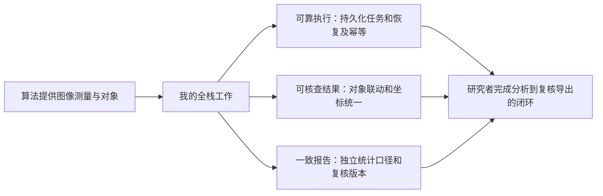

### 2. 五条简历工作怎样讲得有分量

| 简历条目 | 建议主动强调的贡献 | 可用于引导追问的一句话 |
|---|---|---|
| 全栈功能交付 | 梳理图像、ROI、任务、对象、复核及报告的生命周期，让服务边界有清晰契约 | “我先把对象和版本关系定下来，再把前后端流程串通。” |
| 异步算法接入 | 把耗时调用变成可恢复任务，处理算法已经完成但登记尚未完成的窗口 | “这里最关键的是失败恢复和重复执行，而不只是起一个后台线程。” |
| 图像与指标联动 | 将汇总到原图的追溯落实到对象 ID 与配对记录，统一几何坐标 | “研究者点一个距离柱，就能检查对应起点和最近目标。” |
| Ki-67 统计建模 | 用正交维度表达身份与状态，把分母、缺失与质量落实进模型 | “这块主要难在对象定义和统计口径，比例公式本身很简单。” |
| 复核与导出一致性 | 分别解决过期写入、跨侧读取视图和跨请求版本漂移 | “写入、比较和导出各有一种一致性问题，我分别处理。” |

不要只说“我做了 API”“我加了事务”。下一句要补动作的目的和能验证的行为，例如“成功状态与对象入库同事务提交，前端不会看到成功却查不到完整对象”。

### 3. 推荐的亮点开场：约 90 秒

> 这个项目面向**肿瘤微环境**研究，目标是从**多标记组织图像**里得到**细胞候选群体的组成、密度、空间关系和 Ki-67 阳性比例**。我负责全栈工作台及算法服务接入。
>
> 对我来说，主要挑战是把一次算法计算变成完整的分析流程。第一，**分析比较耗时，我设计持久化任务和后台 worker，支持失败重试与重启恢复，并处理重复执行后的结果登记**。第二，研究人员需要检查数字来源，我**统一 ROI 与原图坐标，把统计指标、对象、核轮廓和最近邻连线连接起来**。第三，**研究结果会被人工修订**，我把身份与 Ki-67 状态分开建模，明确可评价分母，并让比较页面与报告绑定复核版本。
>
> 技术栈是 React、ASP.NET Core、MySQL 和 Python/FastAPI。最值得展开的部分是失败恢复，以及用户修改结果后怎样保证对象表、统计和导出保持一致。

结束在工程亮点上即可。项目成果如果被问，再按正式材料补充；开场不用把所有限制和接口名念一遍。

### 4. 三个“你遇到的难点”完整回答模板

以下讲的是设计问题，不预设你发生过某次线上事故。若有真实问题记录，可替换成“当时观察到……，我通过……定位到……”。

**模板一：算法接入可靠性，适合后端岗位。**

> 我重点考虑的是**算法执行和业务结果登记之间的失败窗口**。比如 **Python 已生成结果，但业务进程在入库前退出，系统既要恢复任务，又不能把同一批对象登记两次**。
>
> 我把**任务状态存到 MySQL**，**单 worker 重启后重新排队未完成任务**。**Python 结果按 runId 和输入身份保存，先完整生成再发布**；**重复调用能复用相同输入的完整结果**。**业务端拿到 manifest 后仍做契约校验，然后在事务里按 run 替换对象和产物，并更新成功状态**。
>
> 这样**恢复过程中允许再次尝试，但不会重复累积结果**。这个取舍也保留了后续扩展空间：如果要多 worker，就需要再加原子领取和租约，不能直接复制当前进程。

可以继续聊：超时不等于执行终止、至少一次尝试与幂等、跨文件和数据库的一致性、单实例领取与多实例租约、故障注入怎么做。

**模板二：复核后的版本一致性，适合强调数据库能力。**

> 项目里研究者会**修改对象身份、排除对象或修订 Ki-67 状态**。我的关注点是**这些操作怎样影响后续统计**，而不是只把某个字段更新掉。
>
> 我**保留自动测量，人工修改追加版本**。**提交时带基础版本，事务里锁定任务行，再校验当前版本并分配新版本**；过期提交直接返回冲突。比较两个 ROI 时，我在同一个可重复读事务中构建两侧快照。页面拿到明确版本后，下载继续传这两个版本，不能再读最新。
>
> 比如页面是 A 的 v4 和 B 的 v7，即使后来有人把 A 改到 v5，下载仍按 v4/v7 生成。这个例子能说明为什么版本号、事务快照和公共统计逻辑都需要。

可以继续聊：乐观版本前提与悲观行锁配合、MVCC、锁定读与一致性读、不可变历史、身份改动引发距离重算。

**模板三：图像与统计可核查，适合强调全栈协作。**

> 这个项目里**图像展示和统计不能脱节**。研究者**看到一个计数，需要知道对应的是哪些对象**；看到一个距离区间，需要知道哪些起点和目标产生了这些距离。
>
> 我让接口**返回对象 ID、有效身份、原图坐标和最近邻配对**，**前端按同一份对象数据筛选和高亮**。算法裁剪图属于 ROI 局部坐标，我把它按 ROI 原点放回原图，轮廓和连线使用接口给出的原图坐标，所有图层共享缩放和平移。
>
> 因此指标不仅是一张统计表，它还是回图核查的入口。技术上能继续展开坐标契约、单位换算、距离分箱，以及修订后哪些对象和配对需要更新。

可以继续聊：逆坐标变换、区间端点、像素与 µm、指标分母与筛选集合一致、只改展示与改测量的区别。

### 5. 主动把问题引向熟悉的部分

面试官问“简单讲讲”，按背景、职责、三个亮点结束。面试官问“最难的是什么”，优先选最能提供真实证据的一条，不要一次展开全部。

| 面试官的问题 | 可用的回答开头 | 后续应能接住 |
|---|---|---|
| “你主要负责什么？” | “我负责完整分析工作台，重点是让算法结果可以管理、复核和追溯。” | 一次用户操作与各服务职责 |
| “后台异步有什么难的？” | “后台执行本身简单，难的是执行完成与业务登记之间发生故障。” | 已完成文件复用、状态恢复与事务 |
| “为什么这么强调版本？” | “比较和下载是不同请求，读最新就可能把页面的旧数字换掉。” | A(v4)/B(v7) 算例 |
| “Ki-67 不就是除法？” | “除法很简单，关键是先确定目标群和哪些对象能进分母。” | 独立身份、30/90、覆盖率和 null |
| “前端有什么技术点？” | “几何坐标和统计对象共享同一契约，缩放后仍要能核查同一个对象。” | ROI 偏移、对象 ID 与图层变换 |
| “项目有什么价值？” | “把分散的分析和人工修订连接起来，每个统计都能回到对象，并导出对应版本。” | 功能证据与尚未测量的收益 |

### 6. 面向 Java 后端岗位怎样迁移表达

不要为了贴岗位把 ASP.NET Core 改说成 Spring Boot。可以说明技术栈不同，但任务生命周期、幂等登记、事务快照和冲突控制是相通的工程问题。

> 虽然这个项目的业务服务用 ASP.NET Core，但我解决的问题与 Java 后端一致：后台任务需要持久化状态和可恢复执行，外部计算结果需要校验和幂等登记，修改流程需要控制并发与版本。换成 Spring Boot，我会保留这些契约与状态设计，再结合任务规模选择调度器或消息队列。

如果被问缓存、Redis、MQ 或分布式锁，先讲项目实际有没有用，再给扩展条件。与其塞进更多组件，不如解释为什么现阶段数据库任务表足够，以及什么时候该升级。

### 7. 包装后的“个人价值”收尾

> 我在这个项目里的贡献，是把算法输出变成可使用的业务结果：执行失败能恢复，统计数字能追到对象，人工修订后报告能固定到对应版本。这些设计贯穿了前端、算法接口、数据模型和数据库事务，所以我能沿着一次分析讲清整条链路。

这句话用于回答“你做了什么”，不替代结果材料。实际成果能证明到哪一步，就把那一步讲具体。


## A. 项目背景：把医学问题讲成开发者听得懂的需求

### A1. 最终简历背景原文

> 面向肿瘤微环境研究，针对**多标记荧光信号重叠、人工计数繁琐及统计口径不统一**的问题，构建**高光谱免疫荧光图像分析平台**。通过光谱解混分离 panCK、CD3/CD8、Ki-67 等标记信号，定量分析上皮与 T 细胞候选群体的组成、密度、空间关系及 Ki-67 核内增殖标记阳性比例等数据。

这段话可以拆成“研究问题 → 输入为什么难 → 自动分析为什么不够 → 平台怎样形成可信数字”。面试先把这条因果链讲明白，再谈技术栈。

### A2. 研究者到底想知道什么

肿瘤微环境涉及肿瘤周围的细胞、分子与血管等成分；研究不能只关注肿瘤细胞本身，还会关心周围组成与位置。[NCI 定义](https://www.cancer.gov/publications/dictionaries/cancer-terms/def/tumor-microenvironment)

在本项目的研究场景里，可以把问题说成：**选定一块组织区域，上皮与 T 细胞候选对象各有多少，T 细胞亚群怎样分布，距上皮候选对象多远，各目标群中有多少 Ki-67 阳性对象？** 这是组织图像的描述性定量分析；这些数字本身不能直接判断治疗效果。

| 研究者的问题 | 平台需要保留的数据 | 输出 |
|---|---|---|
| 有哪些候选群体、各有多少？ | 同一对象的多项标记测量、身份判定 | 数量、组成比例 |
| 两个区域对象多少是否可比？ | 有效组织掩膜、像素物理尺寸 | 每 mm² 对象密度 |
| 一类对象靠近另一类吗？ | 对象坐标、起点与目标类别 | 定向最近邻距离、配对与分布 |
| 指定群体中多少核呈 Ki-67 阳性？ | 目标群身份、核内测量、可评价状态 | 阳性比例、分子分母、覆盖率 |
| 数字有问题时能查到原因吗？ | 原图、测量、自动标签、人工修订、版本 | 回图核查与可追溯导出 |

多标记组织分析通常把信号分离、对象及其区室识别、表型和下游统计衔接起来；图像分析质量与报告方法也需要明确。[SITC 图像分析建议](https://jitc.bmj.com/content/13/1/e008875)

### A3. 从组织到图像：为什么会出现多标记信号重叠

组织中的目标需要经过实验染色才能产生可测信号。抗体针对相应目标，关联的荧光来源产生光信号，设备记录不同波长范围的强度。**标记是要观察的生物学线索，波段是设备的观测维度，展示颜色是界面选择。** 三者不能混用。

举例：设备采了 24 个波段，并不表示检测了 24 个蛋白。一种荧光来源可能覆盖多个波段，同一波段可能接收到多个荧光来源以及组织自发荧光。因而某个波段亮，不能直接说某个标记阳性。单染参考谱和适当对照帮助区分信号来源；它们属于实验与分析输入，不由前端生成。[SITC 染色与验证建议](https://jitc.bmj.com/content/8/1/e000155)

光谱解混可以用概念式 `观测光谱 ≈ 参考谱 × 各来源贡献 + 残差`理解：参考谱描述每种来源在各波段的形状，算法估计每个像素中各来源的贡献，产生各标记图。它解决“信号来自谁”；分割解决“对象边界在哪”；逐对象测量解决“对象中的信号多少”；表型判定解决“符合哪组标记条件”。四步各有职责。

当前实现的解混方法见 [model.py](../../inference/app/model.py)，使用提供的模拟参考谱进行确定性计算。面试可以解释接口与方法目的，不把当前模拟方法说成自己训练的深度学习网络。

### A4. 五项标记各自干什么，为什么必须关联到同一个对象

| 标记 | 本项目里的角色 | 平台怎样使用 | 表达边界 |
|---|---|---|---|
| DAPI | 定位细胞核 | 得到核对象、位置与轮廓，为其他测量建立对象归属 | 核分割不等于完整细胞分割 |
| panCK | 提供上皮相关身份线索 | 建立上皮候选对象群 | 正常上皮也可能阳性，不能单独确认恶性 |
| CD3 | 提供 T 细胞相关身份线索 | 建立 T 细胞候选群 | 仍需结合质量与信号归属 |
| CD8 | 与 CD3 联合描述亚群 | 区分 CD3⁺CD8⁺ 候选群 | CD8 单阳性不直接等于该 T 细胞亚群 |
| Ki-67 | 描述核内增殖标记状态 | 在目标群内独立判定阳性/阴性等状态 | 不能把所有阳性核都叫增殖肿瘤细胞 |

例如对象 17 的 CD3、CD8 均达到阈值，才能把它放入双阳性候选群。对象 17 的 CD3 亮、邻居 18 的 CD8 亮，不能拼成一个双阳性对象。核及近似核周区域的测量方法、身份规则和局限见 [医学概念与算法边界](02-医学概念与算法边界.md)。

“候选”这个词有实际意义：平台使用有限面板、指定测量区与规则形成推断，保留复核入口。CD3⁺CD8⁺ 与上皮候选对象距离近也只说明空间接近，不能单凭这点宣称发生了免疫杀伤。

### A5. 三个痛点怎样落到开发任务

| 简历中的痛点 | 具体表现 | 对应开发工作 |
|---|---|---|
| 信号重叠 | 原始波段无法直接代表标记，展示与定量容易混淆 | 接入光谱分析服务，管理面板与结果引用，显示独立标记图 |
| 人工计数繁琐 | 对象多，重复观察、记录和换算耗时；错误难追查 | 分析任务、逐对象表、分类汇总、指标回图与人工复核 |
| 统计口径不统一 | 用 ROI 面积还是组织面积？未知算不算阴性？修改后导出哪个版本？ | 明确分母与单位，独立状态，统一统计逻辑和版本绑定 |

平台的价值是把算法输出变成可使用、可核查、可重复取得的研究结果。没有实测时，可以说“减少重复操作、使口径可追溯”，不要补一个提效百分比。

### A6. 一个能讲清四类指标的例子

以下为教学假设，**不是实验结论或项目实测**。A 区域找到 20 个 CD3⁺CD8⁺ 候选对象，有效组织面积 0.10 mm²；B 也有 20 个，但面积 0.20 mm²。A 的密度是 200 个/mm²，B 是 100 个/mm²；数量相同不代表密度相同。

若 A 有 100 个可分类对象，双阳性对象占 20%；若另一个问题是“它们占全部 T 细胞候选多少”，分母要改成 CD3 单阳性与 CD3⁺CD8⁺ 的并集。比例与密度不能互相替代。

再给每个双阳性起点找到本 ROI 内最近的上皮候选核中心，才能产生距离配对。统计平均距离时只纳入有效配对，目标集合为空时返回不可计算。Ki-67 则在指定身份群中另算阳性/可评价数，详见 E 节。

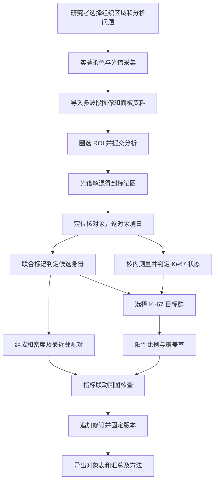

图中实验环节说明真实研究的上游；本仓库以合成生成器替代。当前核检测和核周近似测量不代表经过验证的全细胞分割。

### A7. 背景话术：约 60～90 秒

> 这个项目面向肿瘤微环境研究。研究者关心的不只是图里有多少细胞，还想看上皮和 T 细胞候选群体的组成、单位面积密度、两类对象的空间接近程度，以及指定群体里的 Ki-67 阳性比例。
>
> 实验会在同一组织上做多项荧光标记，设备采集不同波段，但波段和标记不是一一对应的，信号会重叠，所以需要先做光谱解混，再定位对象、关联各标记并进行测量。人工把这些步骤分开处理，容易重复计数或采用不同分母，修订后也难保证图与报告一致。
>
> 我负责的平台部分把导入、ROI、异步分析、图像展示、统计、复核和导出连接起来。重点是让一个汇总数字能追到具体对象，并让人工修改后的页面和报告采用同一版本。算法与平台之间通过明确的文件及对象契约衔接。

**追问：为什么用高光谱，普通 RGB 不行吗？** 回答“研究输入需要分离相互重叠的标记来源，更多光谱观测配合参考谱提供了分离依据；普通彩色截图通常缺少完整定量信息。实际是否需要高光谱仍取决于染色面板与采集方案”。不要宣称任何面板都必须高光谱。

**追问：主要用户是谁，是否用于诊断？** 回答“定位是研究分析工作台，研究者定义比较问题，专业人员复核对象和区域，算法人员提供分析能力。当前复现没有真实医学验证，不据此提供诊断结论”。

## B. 第 1 条：全栈功能交付

### B1. 简历原文与面试官关注点

> 全栈功能交付：基于 React、ASP.NET Core 与 MySQL 开发分析工作台及业务 API，实现高光谱图像导入、ROI 圈选、多通道叠加、分析任务管理、细胞与 Ki-67 指标统计、人工复核及报告导出。

这条要证明你能把一个完整流程落地：输入怎样校验、各层职责怎样分配、页面使用哪些数据、结果修改后如何刷新。功能名称只是入口，重点是它们共享什么对象和版本。

### B2. 服务职责和存储分工

| 组件 | 负责什么 | 不应混进来的职责 |
|---|---|---|
| React 工作台 | 上传、ROI 交互、任务状态、图层、对象筛选、复核和下载 | 另写一份独立统计公式作为权威口径 |
| ASP.NET Core API | 图像/ROI/任务管理，结果校验，规则分类、统计、修订与导出 | 在上传 HTTP 请求里等待整段图像分析 |
| 后台 worker | 消费持久化排队任务，调用 Python，校验并登记结果 | 在没有领取机制时声称支持多实例抢任务 |
| Python/FastAPI | 图像检查、解混、对象检测、测量及文件产物 | 决定用户当前看到哪个人工复核版本 |
| MySQL | 图像元数据、ROI、任务状态、逐对象测量、产物索引、修订记录 | 存放全部大图与大数组二进制 |
| 共享文件存储 | OME-TIFF、assay、标记图、掩膜、定量图、QC 等 | 用可任意访问的路径替代受控 key |

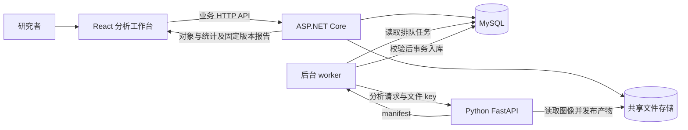

前端入口见 [App.tsx](../../frontend/src/App.tsx)，API 见 [Program.cs](../../backend/OncoMosaic.Api/Program.cs)，文件引用与路径控制见 [Storage.cs](../../backend/OncoMosaic.Api/Storage.cs)。这是当前架构；技术选型的历史理由应按实际团队情况回答。

### B3. 一次完整操作与数据模型

1. **导入：** 当前输入为 OME-TIFF 加 assay 伴随文件，后者包含面板、参考谱与采集信息。检查尺寸、波段、物理像素尺寸及支持条件，保存图像元数据和文件引用。
2. **圈选 ROI：** 鼠标点先转换到原图坐标，得到矩形并限制在图像范围内。当前实现矩形 ROI；任意多边形不是现有交付。
3. **提交任务：** 指定图像、ROI、模型版本与阈值方案，创建 `runId` 和 `Queued` 状态，前端查询任务状态。
4. **分析与展示：** 成功后读取该 run 的对象、标记图和统计；对象坐标属于原图，裁剪标记图放到对应 ROI 位置。
5. **复核：** 查看对象的自动身份与 Ki-67 状态，按维度提交修改，取得新 `reviewVersion`。
6. **导出：** 以选定 run 和复核版本生成对象表、区域汇总、图及方法说明。当前报告是 ZIP 内 CSV/JSON/PNG 等文件，不要讲成已实现排版 PDF 报告。

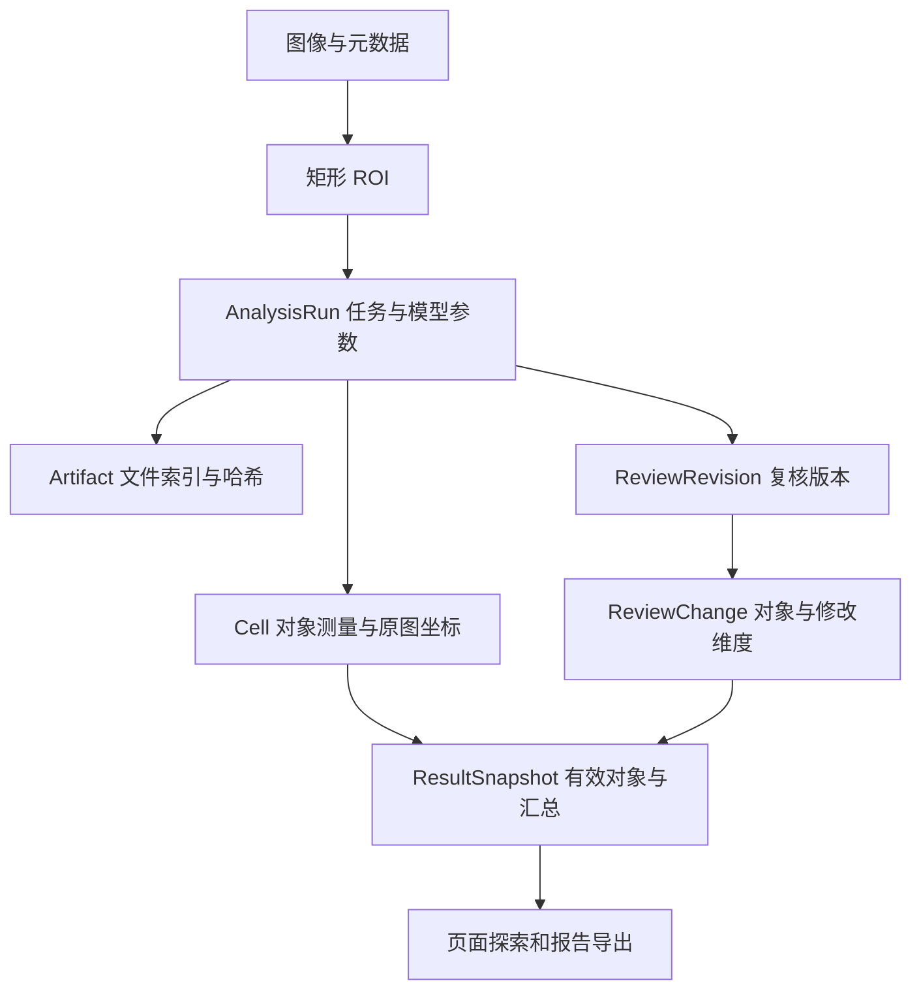

图像、ROI、分析任务是不同身份：同一图像可以有多个 ROI，同一 ROI 可以采用不同方案分析。自动结果版本与人工复核版本也不是同一个概念。

### B4. 约 60 秒话术

> 我负责把分析流程做成一个完整工作台。React 处理图像交互、任务状态和结果复核；ASP.NET Core 管理图像、ROI、任务、统计与版本；Python 接收图像引用和 ROI，返回测量与产物清单。大文件放共享存储，MySQL 保存结构化数据及关联关系。
>
> 比如用户圈选一个 ROI 后，后端创建任务并返回 ID，后台完成分析后，页面按这个任务加载标记图、核轮廓和对象统计。研究者修改对象时，我们追加复核记录，重新生成有效结果，导出也绑定同一个版本。这样功能串在同一条数据链上，数字能查到来源。

### B5. 深入追问

**为什么 C# 与 Python 分开？** 业务规则、事务和对象生命周期由业务服务统一处理，图像库及分析计算留在 Python。服务边界通过 `runId`、ROI、文件 key、产物清单和坐标约定固定。分开是职责和依赖的取舍，不需要宣称 C# 必然更快。

**为什么不用消息队列？** 当前单 worker、串行任务量可以先用 MySQL 持久化任务表，减少部署组件，同时支持恢复。扩展到多 worker 时需原子领取、租约和超时回收；引入消息队列后仍要处理重复消费、任务状态与幂等。

**上传大文件、整切片怎么做？** 当前是局部视野原型，不能把分片上传、瓦片金字塔、块间去重等方案当成交付。可以说明扩展方向：上传与分析分离，前端按视野加载，后端分块并统一原图坐标，同时处理块边缘。

**怎么验收？** 先验证文件到对象及报告的闭环，再验证异常输入、坐标和单位、版本回放、故障重试。已有结果见 [验收记录](../VERIFICATION.md)，工程验收不等于医学准确率。

## C. 第 2 条：异步算法接入

### C1. 简历原文

> 异步算法接入：通过后台 worker 和持久化任务状态机对接 Python/FastAPI 分析服务，支持状态轮询、失败重试与重启恢复；图像和掩膜通过共享存储引用传递，结果校验后事务入库，避免长请求阻塞及重试重复写入。

“异步”指用户提交和后台执行解耦。当前 worker 调用 `/v1/analyze` 仍要等待该次 Python HTTP 返回；Python 没有另外提供任务查询协议。`async/await` 和这层业务异步不是一回事。

### C2. 主链路与真实状态机

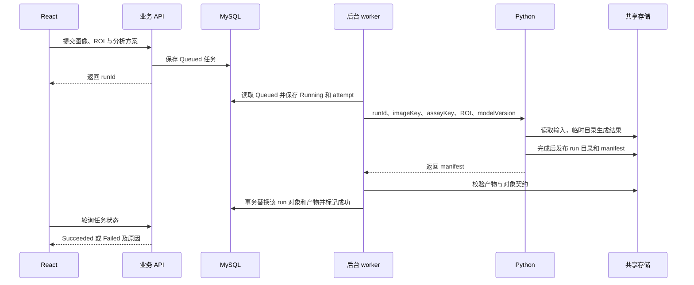

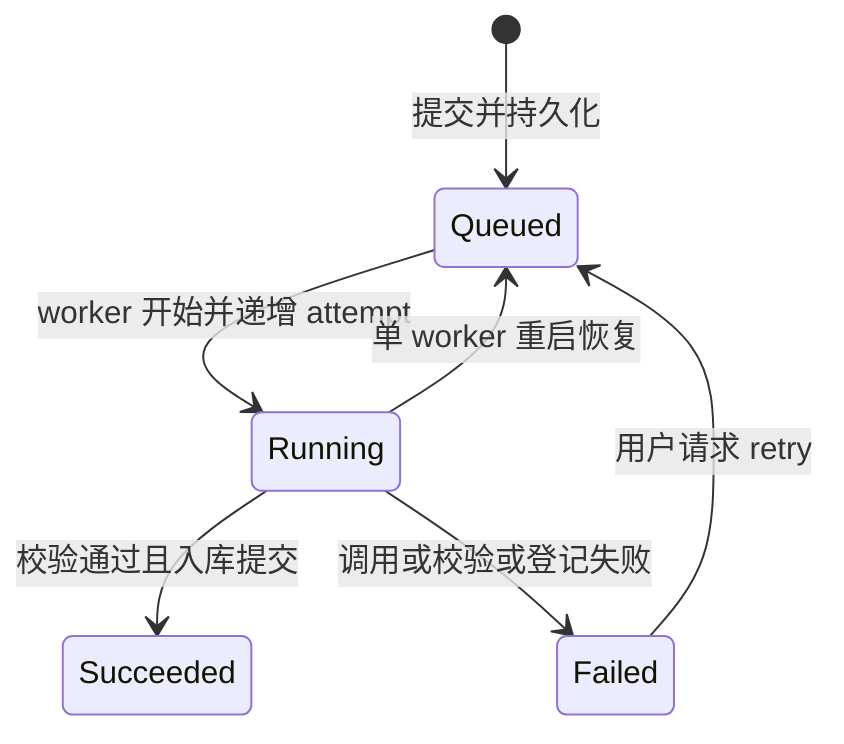

当前没有自动指数退避、死信队列、取消状态或并行调度。`Failed` 后由重试接口转回排队；服务重启时将支持模型的残留 `Running` 任务恢复为 `Queued`。它依赖“部署只有一个 worker”，多实例不能照搬启动时全量回收。

### C3. 什么要持久化，文件引用怎样传

任务保存 `runId`、ROI、模型和统计版本、阈值、状态、`attempt`、开始/结束时间、错误码及消息。进程退出后，前端查到的状态和 worker 恢复依据都来自数据库，不能只存在内存队列。

请求传 `imageKey`、`assayKey`，返回 `maskKey`、`cellsKey`、标记图 key、QC key 等。这些是共享存储中的相对引用，由服务端解析到受控根目录；不传前端本机绝对路径，也不用 JSON/base64 搬运所有图像数组。元数据适合 HTTP，大数组适合文件。

接口输出的 `manifest` 可以理解为结果目录：说明属于哪个任务、模型和 ROI，包含多少对象、哪些文件及有效组织像素数。它不是“算法返回 200 就直接接受”的捷径。

### C4. 校验和幂等分别解决什么

[AnalysisWorker.Validate](../../backend/OncoMosaic.Api/AnalysisWorker.cs)检查任务、模型、ROI 和尺寸是否一致，文件是否位于该 run 目录，标记与面板是否匹配，对象索引是否唯一、坐标是否在 ROI 内，掩膜与对象测量是否一致，面积和数值是否有效；五标记结果还校验输入身份与核内定量图。校验后才发布为成功。

| 层次 | 当前做法 | 解决的问题 |
|---|---|---|
| Python 输入身份 | `runId` 关联图像/assay 哈希、ROI 和模型，已发布 manifest 身份相同才复用 | 同一 run 不能对应另一份输入 |
| 文件发布 | 在临时目录完整生成，再重命名为 run 目录 | 避免把部分文件当成完整结果 |
| Python 并发 | 单进程分析锁 | 限制本进程同时处理；不是分布式锁 |
| 数据库登记 | 事务内删除同 run 的旧对象/产物，再写入并标记成功 | 重复登记后不累加两份对象 |
| 任务重试 | 保留 runId，重新排队，开始执行时增加 attempt | 同一逻辑任务可以重复尝试 |

“避免重复写入”更准确的展开是**避免同一任务重试后重复累积结果**，并不表示数据库物理上只写过一次。当前方案也不提供分布式 exactly-once。

### C5. 面试最有说服力的三种故障场景

| 故障时点 | 会留下什么 | 怎样恢复 |
|---|---|---|
| Python 调用失败或产物无效 | 任务 `Failed`，保存错误信息，不发布成功结果 | 恢复服务/修复输入后手动 retry；确定性坏输入不能靠反复重试解决 |
| Python 已发布结果，API 未登记便退出 | run 文件可能完整，任务仍 `Running` | worker 重启重新排队；同 run 的相同输入复用 manifest，再校验和登记 |
| 登记对象时事务失败 | 该事务内修改回滚，不得到部分成功记录 | 任务失败后重试；完整文件可再次利用 |

文件系统与 MySQL 不在同一个数据库事务里。这里采用“先完整发布文件，后事务登记数据库”的顺序；可能存在未登记文件，今后可增加清理与对账。不要宣称数据库回滚会自动删掉文件。

### C6. 约 90 秒话术与追问

> 图像分析耗时，所以**用户提交时只创建持久化任务并返回 ID**，后台 worker 再调用 Python，**前端轮询状态**。任务有排队、执行、成功和失败四个状态，失败后可以重试；在当前单 worker 部署下，重启会把未完成的执行中任务重新排队。
>
> 我重点处理结果完整性和重试幂等。**图像、掩膜**通过共享文件 key 传递，**Python 先在临时目录完成全部产物，再发布 manifest**。业务端校验任务身份、ROI、文件尺寸、对象和掩膜的一致性，随后在同一个数据库事务里登记对象、产物和成功状态。
>
> 如果 Python 算完后业务进程退出，恢复后同一个 runId 可以复用匹配输入的结果，再登记。数据库按该 run 替换结果，避免重试后计数翻倍。当前是单 worker 方案；多实例扩展还要补原子领取和租约。

**HTTP 超时能否证明 Python 停止了？** 不能，调用方超时后 Python 可能继续。当前单进程锁和完成结果复用降低重复冲突；在更大规模下要引入独立任务协议和执行租约，不能靠无限延长 HTTP 超时解决。

**用户点两次提交，也会得到同一个 runId 吗？** 当前每次新提交创建新 run，已有幂等主要覆盖同 run 重试，不是按图像自动去重。若需要提交去重，可设计客户端幂等键及数据库唯一约束，明确哪些参数构成同一次请求。

**为什么轮询而不是 WebSocket？** 状态变化频率不高，查询 API 简单、容易恢复；多连接或高频进度时再评估 SSE/WebSocket。轮询与结果版本管理仍是两件事。

## D. 第 3 条：图像与指标联动

### D1. 简历原文

> 图像与指标联动：统一原图坐标与 ROI 偏移，在 React 工作台实现标记图、核轮廓及最近邻连线叠加；支持点击统计指标或距离区间定位对应对象，使汇总数字可回到原图核查。

业务目的：研究者看到“18 个双阳性对象”时，可以找出是哪 18 个；看到一个异常距离时，可以检查起点、目标、轮廓和标记信号。联动靠对象身份与统计口径，不靠在彩色图上猜一个亮点。

### D2. 三套坐标如何转换

| 坐标 | 含义 | 当前约定 |
|---|---|---|
| 原图坐标 | 整张输入图像中的像素位置 | 对象中心、轮廓和最近邻配对使用它 |
| ROI 局部坐标 | 裁剪结果内的位置 | 标记图与掩膜宽高等于 ROI；显示时加 ROI 原点 |
| 查看器坐标 | 缩放和平移后的屏幕位置 | 所有图层应用同一个变换；鼠标操作用逆变换 |

公式：`原图点 = ROI 局部点 + ROI 原点`；`屏幕点 = 原图点 × scale + translate`；`原图点 = (屏幕点 - translate) / scale`。

教学算例：ROI 左上角 `(100,200)`，局部对象 `(30,40)`，原图坐标为 `(130,240)`；若 scale=2、平移=(10,20)，屏幕位置为 `(270,500)`。接口已经给原图坐标时，前端不能再加一次 ROI 偏移，否则对象整体错位。坐标计算见 [geometry.ts](../../frontend/src/geometry.ts)，图层放置见 [Viewer.tsx](../../frontend/src/Viewer.tsx)。

当前预览按原图尺寸放置，裁剪标记图按 ROI 的 x/y/width/height 放置；对象轮廓和连线都是原图坐标，再由 SVG 图层统一缩放平移。显示图的颜色/透明度改变观看效果，不改变定量测量值。

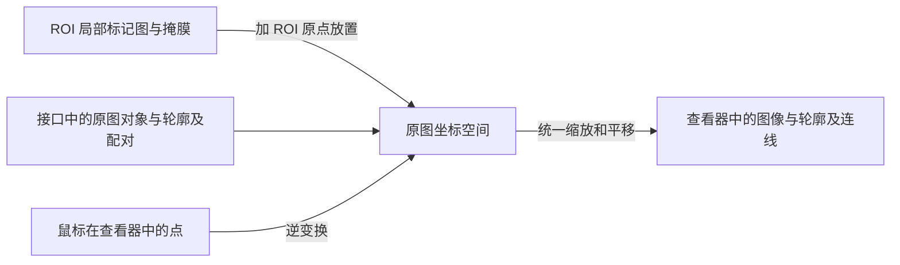

### D3. 数字怎样对应对象，距离区间怎样对应配对

页面读取同一 run 和复核版本的有效对象与最近邻配对。点击类别/指标时，依据有效标签或 Ki-67 群体与状态筛出对象 ID；点击距离区间时，在配对中筛距离，取得起点 ID，再显示对象与相关连线。点击具体对象会将它移到查看器中心。实现见 [exploration.ts](../../frontend/src/exploration.ts)。

直方图区间通常用 `[min,max)`，最后一个区间包含右端点。A、B 比较采用共同分箱边界，否则两侧同一柱位置可能代表不同距离范围。还要区分“区间对应的起点”和“为了显示连线同时出现的目标”；两者不是同一个计数。

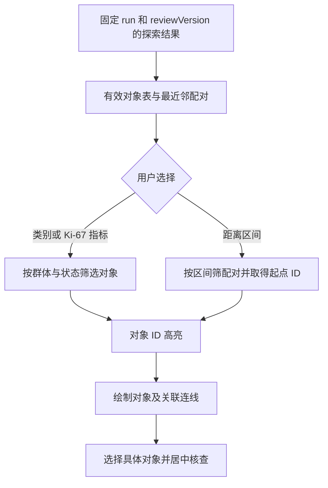

### D4. 最近邻距离：公式与边界

当前定义是**从 ROI 内每个 CD3⁺CD8⁺ 候选核中心，到同 ROI 内最近的不同 panCK 候选核中心**。像素距离乘 `pixelSizeUm` 得到 µm；不是边界距离，也不跨 ROI 寻找目标。实现见 [Quantification.Neighbors](../../backend/OncoMosaic.Api/Quantification.cs)。

教学算例：两点 `(10,20)`、`(13,24)` 相距 5 像素，像素尺寸 0.5 µm，距离为 2.5 µm。正向与反向使用不同起点集合，均值通常不同；目标空时没有配对，均值为 null，不能返回 0。多个起点可以选择同一个最近目标。

当前按起点遍历目标计算，复杂度约 `O(N来源 × N目标)`，适合局部视野；大规模可考虑空间索引。ROI 边缘可能截掉真正最近目标，当前没有边缘校正，应限制解释范围。

### D5. 约 60 秒话术与追问

> 我把指标联动设计成对象级追溯。后端返回同一复核版本下的对象和最近邻配对，前端点击类别时按有效标签筛对象，点击距离柱时按配对距离筛起点，然后在原图中高亮并画到目标的连线。
>
> 技术难点是统一坐标。算法裁剪图和掩膜属于 ROI 局部空间，标记图按 ROI 偏移放回原图；对象和轮廓在接口中已经使用原图坐标。图像、轮廓和连线共享缩放平移，鼠标圈选用逆变换，所以缩放后仍能画在正确位置。
>
> 联动的价值是让研究者检查每个数字对应的信号和对象；当前距离定义是同 ROI 内核中心的定向最近邻，不能直接解释为细胞接触或免疫杀伤。

**只改 Ki-67 为什么不改变最近邻？** 起点、目标由身份标签与坐标决定；单独改 Ki-67 状态没有改变它们。身份修改或排除可能使对象退出集合，并让其他起点重新配对。

**怎么证明图没有错位？** 用已知 ROI 原点和对象坐标验证偏移只加一次，再验证缩放、平移、鼠标逆变换与配对端点；比较像素距离和物理距离。已有相关前端与比较测试，不能只靠截图“看起来对”。

## E. 第 4 条：Ki-67 统计建模

### E1. 简历原文与核心选择

> Ki-67 统计建模：将细胞身份与 Ki-67 状态独立建模，按目标细胞群的可评价对象计算阳性比例，区分阴性、无法判定和未检测。

“细胞身份”回答属于哪类候选对象，“Ki-67 状态”回答该对象的核内增殖标记情况。上皮候选和 T 细胞候选都可以同时具有 Ki-67 状态，不能把“Ki-67 阳性”放进身份互斥枚举而丢掉原身份。

```text
对象 ID：同一个对象的稳定身份
identity：panck / cd3 / cd3-cd8 / negative / unclassified / excluded
ki67：value、quality、autoState、effectiveState、compartment=nucleus
人工修订：cellId + dimension(identity 或 ki67) + newLabel + reviewVersion
```

这里的字段示意用于理解；完整当前类型与算法见 [Ki67.cs](../../backend/OncoMosaic.Api/Ki67.cs)。

### E2. 为什么核内测量，四种状态分别是什么意思

Ki-67 的评估涉及核染色及标准化评分，实验条件、对象选择和评分方法会影响解释。乳腺癌 Ki-67 工作组建议强调测量与评分标准化；它不能作为本平台跨组织通用的阈值依据。[IKWG 建议](https://academic.oup.com/jnci/article/113/7/808/6053794)

当前模拟在核掩膜内测量 Ki-67 平均强度，另存浮点定量图供一致性检查；显示 PNG 是可视化产物，不能直接读其颜色恢复精确测量。panCK/CD3/CD8 使用核及核周近似区，Ki-67 使用核内区，区室不同。

| 状态 | 含义 | 是否进入阳性比例分母 |
|---|---|---|
| positive 阳性 | 有可评价测量且达到该方案阈值，或允许的有效复核状态 | 是 |
| negative 阴性 | 有可评价测量且未达到阈值，或有效复核为阴性 | 是 |
| indeterminate 无法判定 | 检测存在但质控/可解释性不足，或有效复核为不确定 | 否 |
| not-measured 未检测 | 面板或对象没有 Ki-67 测量 | 否 |

零强度在有效检测条件下可以是阴性；缺失值不是零。当前规则不会让用户把未检测或质控不合格对象强行修成有效阳性，Ki-67 修订要求提供原因。

### E3. 分子、分母和覆盖率：必须能口算

先选择目标群，再排除有效性不符合要求的对象，按群中的有效 Ki-67 状态计数：

- `可评价数 E = 阳性 P + 阴性 N`。
- `阳性比例 = P / E`；E=0 时返回 null，P=0 且 E>0 才是 0%。
- `覆盖率 = E / 目标对象数 T`；T=0 时返回 null。
- 排除对象、身份无法判定数与 Ki-67 无法判定数应分别解释，不能合成“阴性”。

教学例子：100 个满足入群条件的上皮候选对象，30 阳性、60 阴性、10 Ki-67 无法判定。阳性比例为 **30/90=33.33%**，覆盖率为 **90/100=90%**。把那 10 个对象视为阴性会得到 30%，这是不同且错误的口径。

| 边界场景 | 应怎样报告 |
|---|---|
| 0 阳性、20 阴性 | 0%，有可评价分母 |
| 0 阳性、0 阴性、10 无法判定 | 比例不可计算；不要显示 0% |
| 四标记旧面板，没有 Ki-67 | 未检测；保留原身份与原有统计 |
| 目标群为空 | 比例与覆盖率不可计算，说明目标群为空 |
| 可评价 10 个、目标群 100 个 | 比例可计算，但覆盖率仅 10%，需要提示解释限制 |

当前群体包括上皮候选 `panck`、全部 T 候选 `cd3`（CD3 单阳性与双阳性并集）、双阳性 `cd3-cd8` 以及 `all`。`all` 表示该实现中质量合格且未排除的全部对象，可能包含身份无法判定对象；它不等于经专业确认的全部肿瘤细胞。

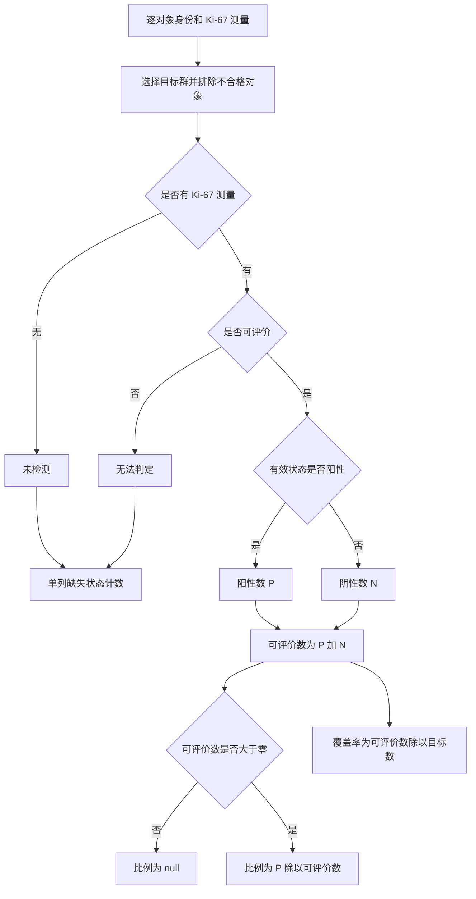

当前模拟“可评价少于 10 或覆盖率低于 80%”时返回探索提示。这些数是代码中的演示门槛，不是医学标准，也不是判断高低增殖的临床阈值。

### E4. 修改影响与兼容

只修改 Ki-67：身份、位置和最近邻不变，Ki-67 分子/分母及有效状态可能改变。修改身份：对象可能进入另一个 Ki-67 目标群，同时影响组成与配对。排除对象：从相关有效统计集合移除；不能只在界面隐藏而仍在分母中计数。

四标记历史数据用未检测状态解释，五标记输入增加核内测量与定量产物。当前模型/统计版本与导出 schema 都明确区分，不能把导出 schemaVersion 当成医学模型版本。旧格式保持原文件集合，新增 Ki-67 文件通过 v2 导出提供。

### E5. 约 60～90 秒话术与追问

> Ki-67 不是一种细胞身份，而是核内增殖标记状态，所以我把它与上皮或 T 细胞候选身份分开保存。这样同一个对象可以既是上皮候选，又是 Ki-67 阳性，复核 Ki-67 时也不会覆盖身份。
>
> 统计先选目标群，再明确可评价对象。比如 100 个上皮候选中，30 阳性、60 阴性、10 无法判定，比例是 30 除以 90，覆盖率是 90%。未检测和无法判定不能当阴性；没有可评价对象时返回空值，区别于真正的 0%。
>
> 我还让页面的分子和分母能定位到具体对象，并通过复核版本保持导出一致。当前复现用核内模拟强度与方案阈值验证工程口径，真实评分阈值和医学效果需要实验验证。

**身份无法判定与 Ki-67 无法判定有何区别？** 前者不知道应该进入哪个身份群，后者不知道增殖标记状态；它们可能独立出现，应分别记录。上皮候选群要求身份明确为 panck；`all` 群的语义不同。

**为什么不直接除以所有核数？** 因为研究问题限定目标群，而且缺少或不可评价测量不能当阴性。全核分母回答另一个问题，也需要证明测量完整性。

**阈值怎么定？是否有热点评分？** 当前阈值来自用户选择的模拟方案，演示 ROI 总体统计。真实阈值需要对照与验证，热点检测和评分不是首期已交付能力。不能将核内荧光均值直接等同于临床评分规则。

## F. 第 5 条：复核与导出一致性

### F1. 简历原文与三层问题

> 复核与导出一致性：保留自动结果并追加人工修订，以基础版本校验防止过期提交；双 ROI 对比通过 MySQL 可重复读事务固定两侧快照，导出显式绑定复核版本，保证页面、对象表和统计报告一致。

这里有三种不同问题：**写入不能覆盖别人更新、一次比较不能混入两次读取时点、下载不能偷偷切到新版本。** 版本检查、读取事务和显式版本分别处理它们，不能用一句“加事务”代替全部解释。

### F2. 保留自动结果，追加修订并回放

当前不覆盖原始测量。`ReviewRevision` 保存该 run 的复核版本，`ReviewChange` 保存对象、修改维度、目标状态和原因。版本 0 表示自动结果，版本 v 的有效对象由自动规则结果叠加 `<=v` 的修订得到；同一对象同一维度取该范围内最后一次修改。

例子：v0 对象 17 为上皮候选且 Ki-67 阳性；v1 只把 Ki-67 改为阴性；v2 排除对象。读 v0 仍能看到原判定，读 v1 身份不变但阳性数减一，读 v2 对象不再进入相应有效统计。时间和原因在修订记录中可追溯。当前没有完整登录鉴权，不能把本地用户占位信息说成真实多人审计系统。

### F3. 基础版本与行锁如何配合

前端提交 `baseReviewVersion`，代表“我是在这个版本上做的修改”。当前事务中先对对应 `AnalysisRuns` 行 `SELECT ... FOR UPDATE`，再读取最新复核版本、验证基线并追加新版本；数据库还约束 `(RunId,Version)` 唯一。

两人都看到 v3：甲持锁校验 v3 并提交 v4；乙取得锁后发现最新已是 v4，乙的基线仍为 v3，返回 `409 REVIEW_CONFLICT`。客户端应载入最新结果、检查冲突并重新决定修改，不能静默换一个基线自动提交。

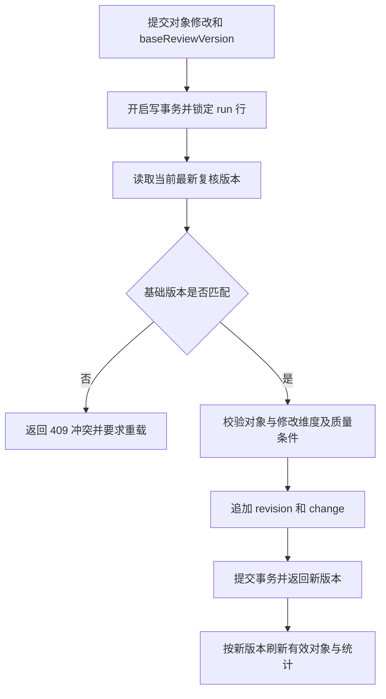

基础版本表达编辑前提，行锁串行化同 run 的版本分配，唯一索引提供约束。只在事务外比较版本再写仍有竞争窗口。当前 v2 和 Ki-67 复核强制提供基础版本；四标记旧接口为了兼容允许省略，不能概括成“所有历史请求一律强制”。实现见 [Program.cs](../../backend/OncoMosaic.Api/Program.cs)。

### F4. 可重复读为什么用于双 ROI 比较

不固定读取快照时，可能先读到 A 的旧版本，再在别人提交后读到 B 的新版本。当前 [ComparisonService.Create](../../backend/OncoMosaic.Api/Comparison.cs)在同一个 `RepeatableRead` 事务内构建 A、B 的结果快照，解析请求中未指定的“最新版本”，然后返回两边明确的 `reviewVersion`。

在 InnoDB 可重复读事务中，普通一致性读通常沿用首次一致性读建立的快照；这里用它固定一次比较的读取视图。`FOR UPDATE` 是锁定读，不能笼统说也读取同一个历史快照。[MySQL 一致性读说明](https://dev.mysql.com/doc/refman/8.4/en/innodb-consistent-read.html)

A 的 v4 与 B 的 v7 可以比较：版本号是各自 run 内的修订序号，不要求相等。“固定两侧快照”不是让两边版本都等于 4，也不是禁止其他人继续复核。

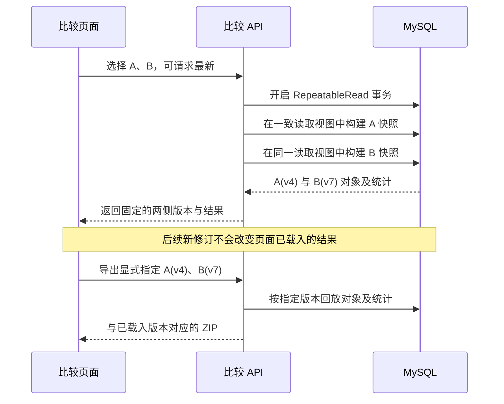

### F5. 下载是新请求，为什么还必须传版本

比较读取事务在返回页面前已经结束，不可能保护几分钟后另一条下载请求。如果下载又查“最新”，A 可能已变为 v5，而页面还显示 v4。因此前端保留已载入的版本，下载请求明确传两侧 runId 和 reviewVersion。

[ResultService.Snapshot](../../backend/OncoMosaic.Api/Results.cs)先得到指定版本的有效对象，再用公共 `Quantification` / `Ki67Quantification` 生成汇总，导出从同一快照形成对象表、统计与方法。单 ROI 导出也应显式指定已显示版本；省略时 API 可以选择最新，不能承诺“省略版本也总与旧页面一致”。

复核变化后，页面提示重新载入；加载新版本是明确动作。历史快照固定依赖自动测量、输入和参数不被偷偷覆盖，以及修订历史保留。若未来支持删除历史/改边界，需要补相应生命周期与重算规则。

### F6. 约 90 秒话术与追问

> 我把一致性分成写入、比较读取和导出三层。自动测量保留，人工修改追加复核版本。提交带上用户看到的基础版本，后端在事务里锁定 run 行再检查版本；如果已经被别人修改，返回冲突，避免旧页面覆盖新结果。
>
> 双 ROI 比较会在同一个可重复读事务中读取两侧，得到一次比较的固定结果，响应中返回各自的复核版本。页面载入后，即使出现新修订，已显示的结果也不会自己变成另一个口径。
>
> 下载是新的请求，所以不能只靠之前那个事务。导出明确传已显示的两侧版本，再用公共快照和统计逻辑生成对象表、汇总和方法。这样页面显示 A 的 v4、B 的 v7 时，下载就仍按这两个版本生成。

**RR 和 Read Committed 的区别在这里怎么体现？** RC 的不同语句可能读取不同已提交视图；RR 的普通一致性读通常复用同一快照。这里用于一组跨表/跨侧读取；未来并非所有接口都需要 RR。

**为什么不使用 Serializable？** 读取固定视图不需要禁止并发复核；当前用一致性快照减少读写互相阻塞，写入冲突在自己的写事务中处理。不能简单说隔离级别越高越好。

**排除一个目标后，其他对象的距离会不会变？** 会，它可能是多个起点的最近目标。按新版本有效身份重建目标集合并重算配对；不能只减一个计数而保留旧距离。旧版本仍用旧集合。

**这算 event sourcing 吗？** 可以说采用了追加修订、按版本回放的思路；当前不是宣称具备完整事件溯源架构。说明实际两张修订表和回放规则即可。

## G. 项目成果、个人职责与整段表达

### G1. 成果原文与需要备好的材料

> 全国大学生创新创业大赛 - 国创奖项，顺利结题。

面试准备要拆开“赛事/奖项、国家级立项、项目结题”三个口径，按本人持有材料说明。当前仓库没有原始证书和结题材料，文档不能替你认定“国创”具体指哪一种；若材料写的是国家级大学生创新创业训练计划立项，宜按该全称说明，不自行改称竞赛获奖。

可用表达模板：

> 这个项目取得的正式成果是【按证书或立项通知填写准确名称】，并完成了结题。我主要负责【真实职责】，结题时我能展示的交付包括【真实交付清单】。算法训练与医学效果由相应负责人提供，我可以重点展开平台接入和工程链路。

方括号是准备时待核实项，不是可以背出来的事实。项目成果证明获认可/完成阶段交付，不直接证明医学准确率或临床有效性。准备材料时记录团队规模、实际分工、当时技术版本、交付范围以及本人主导的一次问题处理，不编造负责人头衔。

### G2. 全项目介绍：30 秒

> 这个项目面向肿瘤微环境研究，把多标记组织图像转成候选细胞群的组成、密度、空间距离与 Ki-67 阳性比例。我负责全栈平台，连接图像导入、ROI、异步分析、统计复核和导出。重点解决耗时算法的恢复与幂等、统计数字到原图对象的联动，以及复核版本下页面和报告的一致性。

### G3. 全项目介绍：约 2 分钟

以下按简历声称的职责展开，历史时间与交付范围核实后使用；最近复现的补充另行标明。

> 这个项目是我在 2022 年 3 月到 9 月参与的肿瘤组织多靶点定量分析平台，面向肿瘤微环境研究。研究者既关心上皮和 T 细胞候选群体有多少，也关心单位面积的密度、它们的空间关系和指定群体的 Ki-67 阳性比例。
>
> 输入是多标记光谱图像，多个波段不直接对应多个标记，所以分析先做光谱解混，再定位对象并测量各项信号。我的工作集中在全栈平台和算法服务接入，把这些分析产物变成可以查看、修改和导出的结果。
>
> 前端使用 React，业务后端是 ASP.NET Core，MySQL 保存任务与对象数据，Python/FastAPI 提供图像分析。图像和掩膜通过共享存储 key 传递。用户提交后返回持久化任务 ID，由后台 worker 执行，支持失败重试和单 worker 重启恢复；结果完成后先校验，再事务登记，避免重试后重复累积对象。
>
> 展示部分统一原图与 ROI 坐标。用户点一个类别计数或距离区间，可以定位对应对象，查看核轮廓与最近邻连线。Ki-67 则与身份独立建模，按指定群的阳性加阴性计算分母，未检测和无法判定单列。
>
> 最后我通过追加修订保留自动结果，提交时检查基础版本；双 ROI 读取固定快照，导出明确使用已显示的复核版本。这个项目最值得展开的是算法接入可靠性和对象到报告的可追溯链路。

如面试中展示本仓库，补充：“这里展示的是近期复现，使用合成数据和确定性算法验证工程闭环，不是当年真实模型的性能证明。”

### G4. 三个可用于 STAR 的技术故事

下面是**从当前实现提炼的讲述框架**；只有确实经历过相应问题，才能作为过去事件回答。否则表述为“为了防止这个场景，我设计了……”。

| 故事 | S/T：问题与目标 | A：关键动作 | R：可验证结果 |
|---|---|---|---|
| 算法完成但业务端退出 | 需要恢复任务且不让计数翻倍 | 持久化状态、同 run 输入身份、完整文件发布、事务登记 | 同 run 重试后对象不重复，attempt 可查 |
| 缩放后对象与裁剪图错位 | ROI 局部与原图坐标混用 | 接口统一对象原图坐标，标记图加 ROI 原点，统一图层变换 | 已知坐标和配对端点可验证，缩放后保持对应 |
| 页面与导出统计不一致 | 页面读旧版本，下载重新读取最新 | 修订回放、双侧读取快照、显式导出版本和公共统计 | 旧版仍可重算，CSV/JSON 与选定快照核对 |

没有实测耗时收益时，R 用上述验收行为，不补“提升 80%”或“零故障”。你真正遇到并解决的问题，应补具体触发、排查证据、修改前后行为和影响范围。

### G5. 面试前最后核对与练习顺序

1. 核实 2022.03—2022.09 的本人参与时间、历史技术栈、五项功能的实际交付时间；区分原项目与后续复现。
2. 核实成果材料的正式名称、项目分工、算法负责范围；模型结构和效果只引用确有证据的数据。
3. 先练 A7 背景，再练 G2/G3 项目介绍，最后分别展开 C、D、E、F 的技术故事。
4. 手绘业务流程、异步时序、坐标变换和复核/导出四张图，不靠背诵工具名称。
5. 口算 30/90、覆盖率、面积换算和最近邻单位，解释 null 与 0 的区别。
6. 准备一次双 ROI 演示：载入比较 → 点指标/距离柱 → 回图 → 修订并重载 → 回放旧版本 → 按已载入版本导出。完整操作见 [第 03 章](03-核心功能与截图演示.md#7-多区域比较与对象联动探索)。

**材料口径：** 简历 PDF 是本轮对齐的正文来源；仓库代码用于解释当前可运行的工程实现，不能据此证明这些实现在 2022 年已经全部存在。当前 Python 是合成数据上的确定性模拟分析，没有训练出的医学模型。本章不代填模型准确率、患者规模、上线用户数或性能提升。面试前应确认 Ki-67、双 ROI 比较和版本机制分别属于原项目还是后续复现；若是后续补充，明确讲“原项目负责……，最近复现时补充了……”。

**当前实现证据入口：** [异步 worker](../../backend/OncoMosaic.Api/AnalysisWorker.cs)、[Python 分析与文件发布](../../inference/app/model.py)、[图层与坐标](../../frontend/src/Viewer.tsx)、[对象筛选](../../frontend/src/exploration.ts)、[身份与距离统计](../../backend/OncoMosaic.Api/Quantification.cs)、[Ki-67 规则](../../backend/OncoMosaic.Api/Ki67.cs)、[复核 API](../../backend/OncoMosaic.Api/Program.cs)、[结果回放与导出](../../backend/OncoMosaic.Api/Results.cs)、[双侧比较快照](../../backend/OncoMosaic.Api/Comparison.cs)、[已有验收](../VERIFICATION.md)。这些入口帮助解释当前代码，不替代历史成果材料。

---

## 补充问答：业务、算法、架构与统计

以下保留通用方案问答，用于扩展练习；其中权限、真实模型、几何编辑和整切片等内容可能属于目标设计，应结合前面逐条解析的当前边界回答。

## 1. 先用一句话说明项目

> OncoMosaic 面向肿瘤组织中的细胞组成与空间关系研究，通过 DAPI、panCK、CD3、CD8 与 Ki-67 的联合分析，把光谱组织图像转成上皮与 T 细胞候选对象的数量、密度、位置关系和核内增殖标记比例，并支持回图复核。

这句话包含四个要点：输入是组织图像，分析对象是组织和细胞，输出是定量结果，使用者是研究人员。

## 2. 三种时长的项目介绍

### 30 秒：说明业务与主流程

> 这是一个面向肿瘤组织研究的多靶点定量分析平台。我们想知道组织中的上皮与 T 细胞候选对象有多少、怎样分布、彼此多近。DAPI 帮助定位核，panCK 提供上皮线索，CD3 与 CD8 组合描述 T 细胞亚群，支持 Ki-67 核内测量，按选定对象群统计阳性比例。平台拆分光谱信号、测量并分类对象，再统计数量、密度和距离。研究者能回到原图复核，导出带方法与版本的报告。

### 2 分钟：说明问题、能力和架构

> 肿瘤相关组织中包含多种细胞。假设两块区域都有 20 个 CD3⁺CD8⁺ 候选对象，它们的面积和细胞分布仍可能不同。因此研究者既需要知道数量，也需要密度和位置关系。
>
> 目标面板采用 DAPI、panCK、CD3、CD8、Ki-67：DAPI 定位核，panCK 提供上皮线索，CD3 与 CD8 联合描述一个 T 细胞亚群，Ki-67 记录独立的核内增殖标记状态，阳性比例按各目标群的可评价对象计算。多项荧光信号可能重叠，算法需要先分离来源，再把信号正确归属到同一个对象，才能联合判定表型。
>
> 平台围绕一次完整的研究分析设计。先管理图像、染色面板、参考光谱和批次信息，再确定 ROI 和分析方案。算法服务负责质量检查、光谱分离、组织分区、核或细胞实例分割，以及逐对象标记测量和表型识别。平台随后形成计数、比例、密度和空间结果，并允许研究者回到图像中修正对象或区域。
>
> 架构上，前端负责多图层查看和复核，业务后端负责项目、任务、版本和统计，Python 服务负责图像分析。大图与掩膜放在文件或对象存储中，数据库保存元数据、对象测量和版本关系。分析作为异步任务运行，结果发布前校验完整性。
>
> 最后，报告绑定输入、模型、参数和复核版本。评价既要看分割和表型是否正确，也要看最终计数与空间指标是否满足研究要求。模型输出的生物学解释始终受面板和验证范围约束。

**介绍当前成果时接上：** 当前原型用合成数据和确定性算法跑通了导入、四/五标记测量、候选分类、Ki-67 比例统计、独立状态复核和导出；完整细胞边界、可靠肿瘤区域确认及真实图像性能还需要建设和验证。不要把上面的目标设计直接当作已完成清单。

### 5 分钟：沿着一个研究场景展开

按下面六段展开，每段讲清一个问题，不必背诵技术名词。

1. **研究问题。** 假设研究者希望比较不同组织区域内 CD3⁺CD8⁺ 候选 T 细胞的密度，以及它们与上皮候选对象的距离。先说明区域、表型和统计口径。
2. **输入资料。** 需要多波段图像、染色与设备资料、参考光谱和对照；训练与评价还需独立的专业标注。说明为什么一张彩色截图不够。
3. **分析能力。** 从质控、信号分离、组织分区到对象检测、测量与分类，逐步得到可检查的中间产物。说明算法要知道哪些结果不确定。
4. **产品体验。** 研究者在多通道图像上检查边界和表型，可修正区域、对象或类别。修改后重算受影响的统计，并保留历史。
5. **工程设计。** 图像和结构化数据分别存储，长任务异步执行；任务身份、原子发布和版本快照保证重试与导出一致性。
6. **验证方法。** 按病例及相关批次隔离开发和测试，分别评价对象识别、测量和最终统计；具体效果只引用已有证据。

## 3. 业务与产品追问

### Q1：为什么要做这个平台？解决了什么问题？

**回答：** 目标是把原本分散的图像查看、算法分析、人工修订和统计导出组织成一致流程。研究者既需要批量得到结果，也需要知道数字来自哪些对象、采用什么参数、经过哪些修改。平台的价值是减少重复操作和口径不一致，并支持结果核查。

**继续追问：怎样证明有价值？** 可以评价完成同一分析任务的时间、人工修订量、报告复现成功率，以及不同操作者采用同一方案时的结果一致性。尚未测量时，应讲评价方案，不编造提升百分比。

### Q2：主要用户是谁？

**回答：** 研究人员负责定义问题和比较样本；病理或相关专业人员负责区域及对象解释与复核；算法人员负责模型和验证；平台管理员管理数据与权限。一个人可能承担多种角色，但系统应能区分其操作权限和责任。

### Q3：一名用户进入平台后会做什么？

**回答：** 创建研究项目，导入图像和实验资料，检查质量，选择 ROI 与分析方案，提交任务，核查结果，修订并确认某个版本，最后导出报告或做跨样本比较。每一步都应明确输入、状态和下一步可执行动作。

### Q4：平台和一个图像分割模型有什么区别？

**回答：** 分割模型提供对象边界。完整平台还需要知道图像来自什么实验、对象测量如何解释、统计采用什么分母、人工改过什么，以及如何保存和复算。模型是图像分析能力的一部分。

### Q5：为什么人工复核是核心功能？

**回答：** 图像中会有失焦、粘连、混合信号等难例，模型不应对所有情况强行给出确定答案。复核应支持查看证据、修正结果并重算。理想设计还要区分改类别与改边界：前者主要影响计数，后者可能同时影响测量和分类。

### Q6：第一阶段怎样控制范围？

**回答：** 先确定一种组织研究任务、一套面板和局部视野流程，完成输入到复核导出的完整能力，再扩展整切片、更多标记和多设备。阶段范围限制的是支持条件；数据模型仍应保留样本、切片、视野和版本关系。

## 4. 医学与光谱追问

### Q7：“多靶点”是什么意思？

**回答：** 在同一张组织图像中检测多项标记，并把它们关联到同一个对象进行联合判断。基础四标记面板是 DAPI 核染料加 panCK、CD3、CD8 三项抗体标记；五标记面板再加入 Ki-67，独立描述核内增殖标记状态。只把几个独立分析工具放在同一个页面，还不能充分展示同一对象的联合表型价值。

**继续追问：四个标记够讲清项目吗？** 够支撑一个范围明确的细胞组成与空间关系故事：定位核、识别上皮和 T 细胞候选、区分 CD3⁺CD8⁺ 亚群，再比较数量、密度和距离。它不覆盖全部细胞类型；新增标记应服务于新的研究问题。

### Q8：高光谱与多重免疫荧光是什么关系？

**回答：** 多重免疫荧光提供来自不同标记的信号，光谱成像记录多个波长范围的观测。分析系统利用光谱信息分离重叠的来源，再进行组织和细胞分析。高光谱提供更丰富的光谱采样，但不会自动赋予细胞医学身份。

### Q9：为什么多个波段不能直接当成多个标记？

**回答：** 同一个荧光来源可能覆盖多个波段，一个波段也可能混有多个来源。因此要结合参考光谱、背景及采集条件估计各标记贡献，不能按波段编号直接命名蛋白。

### Q10：为什么需要单染及其他对照？

**回答：** 单染帮助确定单个来源的光谱，适当的未染、阳性和阴性对照帮助理解背景及染色可靠性。对照应与实验和批次关联；没有可靠上游数据，后续模型很难纠正所有实验错误。[SITC 染色建议](https://jitc.bmj.com/content/8/1/e000155)

### Q11：panCK 阳性是不是肿瘤细胞？

**回答：** panCK 提供上皮相关线索，正常上皮也可能阳性。认定肿瘤还需要适用于该组织类型的形态、标记和病理区域证据。平台应让输出名称与证据强度一致，例如使用“上皮候选对象”。

### Q12：CD8 阳性是不是正在杀伤肿瘤的 T 细胞？

**回答：** CD8 单项不能直接证明这一结论。CD3 与 CD8 组合可帮助描述候选 T 细胞亚群，而功能状态需要额外证据。空间上接近肿瘤区域也不能单独证明发生了杀伤。

**继续追问：CD3 阳性、CD8 阴性就是 CD4 阳性吗？** 不能这样推断，本面板没有测量 CD4。三项抗体标记均阴性也不代表“没有细胞”或“正常细胞”，只能说明对象在这三项判定中阴性。

### Q13：核检测和细胞分割有什么区别？

**回答：** 核检测定位核，完整细胞分割还要确定核外边界。数据缺少可靠膜或胞质信息时，可以提供核及近似测量区，并说明局限；有相应信号和参考标注时，再验证完整细胞分割能力。

## 5. 深度学习与数据追问

### Q14：算法应该实现哪些核心能力？

**回答：** 质量检查、信号分离、组织分区、对象实例分割、逐对象标记测量和表型识别。输出必须能够支持区域与空间统计，并提供问题区域或不确定对象供人工复核。统计公式和版本管理可以由普通程序完成。

### Q15：必须用一个端到端大模型吗？

**回答：** 不必。可以由多个模型与确定性计算模块协作。选择依据是研究目标、数据量、可验证性和维护成本。模块化设计便于知道错误来自组织区、边界还是表型；端到端方案若采用，也要保留足够的评价与解释能力。

### Q16：训练需要什么数据？使用时又需要什么？

**回答：** 训练需要有代表性的图像、实验资料和与任务对应的标注，例如组织区、核边界、对象表型及质量问题。使用时输入新图像及必要实验资料，由模型产生预测。用于最终评价的参考答案应独立保留，不能参与训练或调参。

### Q17：Python 的输入输出怎样设计？

**回答：** 输入是图像引用、采集与染色资料、参考谱或校准引用、ROI、任务配置和模型版本。输出是标记图、组织和对象掩膜、逐对象测量与表型、质量信息及结果清单。大数组通过文件或对象存储传递，接口传引用和结构化信息；坐标和单位必须明确。

### Q18：为什么输出中间图和对象表，不能只返回统计？

**回答：** 汇总错误可能由不同步骤引起。保存区域、对象和测量，才能定位错误、人工修订及重新统计。平台也应区分用于观看的彩图和用于定量的原始精度数据，避免从显示颜色反推强度。

### Q19：遇到不认识的对象怎么办？

**回答：** 应允许未知或无法判定，并给出可核查的原因。若模型提供置信度，还需要评估它是否可信，不能直接把输出分数称为真实正确概率。对于明显超出适用范围的图像，可拒绝分析或要求复核。

### Q20：怎样验证模型，为什么不能只报准确率？

**回答：** 不同功能有不同错误。组织分区关注面积和重要区域；对象识别关注漏检、误检和粘连；表型关注各类混淆；最终还要比较密度与空间指标。总体准确率容易掩盖少数类别或困难区域的问题。评价应对应研究用途，并报告无法判定情况。

### Q21：怎样防止数据泄漏？

**回答：** 按病例及相关切片、批次合理划分开发与测试，避免同一来源的相似图块跨集合。标准化参数、阈值选择和模型选择也只能使用开发数据。最终测试集用于评估已确定的方案。

### Q22：换扫描仪或染色批次后会怎样？

**回答：** 强度和背景可能变化，模型表现也可能下降。平台需要保留设备与批次信息，检查输入是否处于支持范围，并使用适当对照和独立数据评价。归一化到同一数值区间不等于消除了实验差异。

### Q23：没有真实数据时能完成什么？

**回答：** 可以验证文件契约、任务流程、几何与单位计算、复核和导出；也可以用合成数据验证特定算法行为。但真实组织上的识别性能仍需真实数据证明。对于本项目，应将目标算法功能与当前模拟交付分别介绍。

## 6. 架构与工程追问

### Q24：为什么业务后端与 Python 算法分开？

**回答：** 两者的职责和运行资源不同。业务服务处理权限、任务、数据版本和报告；算法服务集中处理图像与模型。通过稳定契约解耦，可以独立升级模型和扩展计算资源，也避免业务请求长时间占用同步连接。

### Q25：图像和结果如何存储？

**回答：** 大图、金字塔、掩膜和定量图适合文件或对象存储；数据库保存项目关系、图像元数据、任务状态、逐对象测量和版本索引。两者以受控标识关联，结果发布时校验引用完整性。根据规模决定是否将大对象表转为分区文件或专门分析存储。

### Q26：为什么使用异步任务？

**回答：** 图像计算耗时且可能需要专门资源。提交接口应快速返回任务 ID，后台调度执行，前端查询状态。失败需有可理解原因，重试保留尝试记录；取消请求还要处理正在写出的结果，避免把半成品标为成功。

### Q27：怎样避免重试导致重复数据？

**回答：** 使用任务 ID 和不可变输入身份绑定一次分析，重复请求先检查是否已有可用结果；文件完成后再发布，数据库通过事务和唯一性约束避免重复登记。分布式部署还需要租约或任务领取机制，不能仅依赖单进程锁。

### Q28：如何保证导出与页面一致？

**回答：** 页面和导出绑定同一结果快照，包括输入、ROI、模型、参数及复核版本。汇总使用统一逻辑，导出时固定快照，避免一边读取、一边被新的修改改变。报告应携带方法和分母信息。

### Q29：人工改了结果，怎样保存？

**回答：** 保留自动结果，追加人工修订及版本关系。记录改了什么、谁改的、修改原因及时间。边界变化会使旧测量失效，应重算相关测量和汇总；不能只改图形而保留旧数值。

### Q30：多人同时复核怎么办？

**回答：** 使用明确的版本号与冲突检测，必要时按区域分配任务。旧版本提交不能悄悄覆盖新修改，冲突应提示比较或合并。可以保留审核状态，区分个人草稿与已确认报告。

### Q31：整切片很大，怎样扩展？

**回答：** 前端按金字塔和瓦片加载，后端按块分析并限制内存；块之间保留必要上下文，统一映射到切片坐标，处理边界重复对象。空间统计不能简单把各块均值相加，要在正确区域和对象集合上汇总。

### Q32：应该怎样优化性能？

**回答：** 先测量瓶颈位于读取、解码、推理、写盘还是数据库，再选择缓存、批处理、并发或计算资源扩展。缓存必须与输入和版本绑定。面试中应给出实测条件及数据规模；没有数据时说明压测计划。

### Q33：权限和数据保护怎样设计？

**回答：** 围绕项目和角色限制图像、复核与导出访问，存储地址不直接暴露，关键修改有审计记录。去标识需要处理元数据和可能存在的图像标识，不能只改文件名。具体控制取决于实际部署和数据使用要求。

## 7. 统计、取舍与情景追问

### Q34：比例和密度为什么都要有？

**回答：** 比例描述某类对象在指定群体中占多少，密度描述单位组织面积有多少。分母不同，回答的问题不同。报告必须写清分母，并单列排除和无法判定对象。

### Q35：有效组织面积为什么重要？

**回答：** ROI 中可能有空白或不适合分析的区域，直接使用整个矩形面积会改变密度解释。但面积掩膜错误也会造成偏差，因此组织区域应能查看和复核，而不是只展示一个面积数字。

### Q36：最近邻距离需要注意什么？

**回答：** 明确从哪类对象到哪类对象，比较核中心还是细胞边界，排除对象与自身配对，并处理 ROI 边缘及缺失目标。没有可配对对象时应表示不可计算，不能填零。距离也不能直接等同生物作用。

### Q37：同一张图换一个 ROI，结果为什么不同？

**回答：** 对象集合、面积和邻域都变了，边缘对象的分割还可能受上下文影响。设计上可保留足够上下文或先做全视野分析再按 ROI 统计，但无论采用哪种方案，都要固定并说明分析语义。

### Q38：模型升级后结果变化，旧报告怎么办？

**回答：** 新模型产生新版本结果，保留旧报告及其输入和方法。可在固定样本集上比较区域、对象和最终指标变化，再决定是否采用。不能覆盖历史结果后仍使用相同版本名称。

### Q39：用户说“图看起来很好，数字却不对”，怎样排查？

**回答：** 从分母、ROI 和单位开始，再检查漏检/重复对象、表型规则及人工版本。最后回到标记测量和输入条件。图像可视化效果只能说明展示情况，不能代替对逐对象数据和计算口径的检查。

### Q40：项目最大的设计难点是什么？

**回答：** 可以选“让医学对象定义与工程数据保持一致”。例如一条记录到底代表核还是完整细胞，强度来自什么区域，人工改边界后哪些值要重算。这些定义不清，算法、界面和统计就可能各自正确却互相矛盾。

**继续追问：你怎样解决？** 讲清对象、坐标、单位、版本和失效规则，给出接口与报告中的对应字段，并用具体场景验证，例如改 ROI、排除对象或升级模型。个人完成的部分应按实际经历陈述。

## 8. 用一个场景串联回答

面试官给出：“研究者上传一张图，要统计某区域的 CD3⁺CD8⁺ 候选对象密度，结果还能人工修正。”

可以按以下顺序回答：

1. 核对图像、面板、物理尺寸、对照和支持范围。
2. 确定 ROI 与有效组织定义，建立版本化分析任务。
3. 产生标记图、组织区、对象边界、测量和表型及质量状态。
4. 用符合定义的对象数除以有效组织面积，显示分母和未知对象。
5. 提供图层和对象定位；类别修订更新计数，区域/边界修订触发相应重算。
6. 固定结果快照，导出对象表、区域统计、方法和质控信息。
7. 用独立参考数据评价对象识别、面积与最终密度，而非只检查接口成功。

## 9. 面试准备清单

| 要准备的材料 | 应能说明什么 |
|---|---|
| 一张业务流程图 | 用户为什么做分析，从输入到报告经过哪些步骤 |
| 一张架构图 | 各服务职责、大图与结构化数据如何流转 |
| 一份输入输出样例 | 图像、实验资料、对象、坐标、单位和质量状态 |
| 一个复核情景 | 修改怎样影响测量、统计与历史版本 |
| 一份验证方案 | 数据如何独立划分，每层效果怎样评估 |
| 一份实际交付说明 | 本人职责、已完成范围、真实证据与待实现目标 |

建议优先练习 30 秒介绍，再练“为什么需要光谱”“算法输入输出”“分母与单位”“版本与复核”四类问题。回答时先说明设计目的，再给一个具体例子，最后补充适用条件。

## Ki-67 扩展应怎样介绍

> 设计上我们新增 Ki-67 核内测量，保留原有上皮和 T 细胞候选身份，另记录阳性、阴性、无法判定与未检测状态。报告按明确对象群统计阳性比例，同时给出分子、可评价分母和覆盖率；当前实现 ROI 总体统计，复核和导出绑定同一版本。热点及真实数据验证仍属后续目标，未来热点与总体需分别报告。

常见追问是“为什么不能直接把 Ki-67 阳性除以全部核数？”因为目标群可能是上皮候选或经确认的肿瘤对象，且未检测和不可评价对象不能当阴性。还需解释 Ki-67 必须在核内测量、panCK 不能单独确认肿瘤、热点不是整体评分，以及新面板需要新的对照和验证。细节见 [Ki-67 功能设计](../Ki67功能设计.md)。

**Ki-67 交付状态：** 首期 ROI 模拟功能已实现，实际操作、字段与限制见 [Ki-67 实施说明](../Ki67实施说明.md)。本文中的热点、完整几何复核及真实医学验证仍为目标设计。
